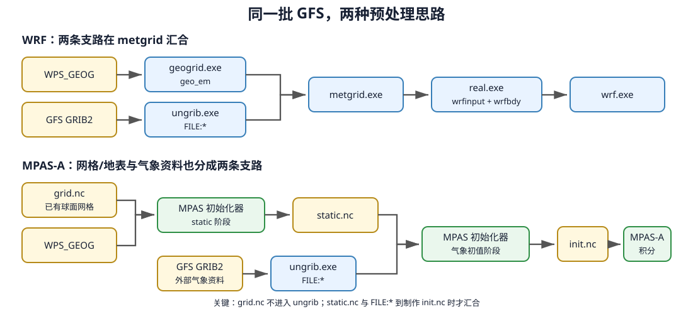

# 第 0 课：从 WRF 走到 MPAS，先把整条路看明白

熟悉 WRF 的话，动力方程可以先放着。要换的是水平网格、资料预处理和数组下标。
WRF 在投影后的矩形网格上积分。MPAS 用多边形铺满球面。这一课只把两条流程对上，
不跑程序。

看完应能指出三处。水平网格在哪一步写进文件，GFS 从哪进模式，静态地理资料在
哪里和气象场合到一起。



图里 MPAS 有两条支路，互不经过对方。

- `grid.nc` 与 WPS_GEOG（WPS 静态地理资料目录）一起生成 `static.nc`；
- GFS 资料经过 `ungrib.exe` 解码，生成 `FILE:*` 中间文件。

两路资料到做 `init.nc` 时才汇合。`grid.nc` 不进 `ungrib.exe`。查初值问题时，网格这一路
和 GFS 这一路分开看。

## 先认识网格上的三个位置

MPAS 网格由多边形组成。一块多边形是网格单元（**cell**），两个单元共用的线段是边
（**edge**），几条边相交的点是顶点（**vertex**）。`nCells`、`nEdges`、`nVertices`
是这三类位置的个数。WRF 的南北、东西格点数是另一套计数，这里没有。

先记住这三个名字。第 3 课会把真实网格画出来，看它们怎么连。第 7 课再讲温度、风和
涡度各放在哪一类位置上。

## 用 WRF 的经验来理解 MPAS

| 你在 WRF 中做的事 | MPAS 中怎样做 | 需要特别留意的地方 |
|---|---|---|
| 用 `geogrid.exe` 定义区域 | 选择或生成 `grid.nc` | 运行模式前，水平网格已经写进文件 |
| 设置中心点、投影、`dx/e_we` | 选择网格，必要时移动已有加密区 | 不能靠 namelist 临时生成全球网格 |
| 用 `ungrib.exe` 解码 GFS | 仍然使用 `ungrib.exe` | 解码时还不需要知道最终采用哪张 MPAS 网格 |
| 运行 `metgrid.exe` 和 `real.exe` | 运行 MPAS 初始化程序 | 它负责插值到非结构网格，并建立垂直状态 |
| 得到 `wrfinput_d01` | 得到 `*.init.nc` | 文件里保存 MPAS 网格上的起报状态 |
| 得到 `wrfbdy_d01` | 全球算例不需要对应文件 | 闭合球面没有侧边界 |
| 修改 `namelist.input` | 修改 `namelist.atmosphere` 和 `streams.atmosphere` | 前者管计算，后者管文件读写 |
| 使用 `(south_north, west_east)` | 使用 `nCells/nEdges/nVertices` | 非结构网格没有规则的 `i,j` 下标 |

仓库装好后有 `mpas_init_atmosphere`。案例脚本再给它一个软链接，用官方文档里常见的
名字 `init_atmosphere_model`。两个名字是同一个初始化程序。

## 从网格到初值，会遇到哪些文件

从网格走到初值，会碰到四类文件。

1. `grid.nc` 保存网格位置、面积和相邻关系。
2. `static.nc` 在这张网格上加上地形、土壤、土地利用等静态资料。
3. `FILE:*` 是 WPS 从 GFS 解码出的中间格式（intermediate format）气象资料。
4. `init.nc` 把 `static.nc` 和起报时刻的气象资料合成模式初值。

只有 `init.nc` 还不能开报。运行还要 namelist、streams、物理过程查找表和 MPI 网格分区。
第 3、5、6 课第一次用到时再逐个看，现在不必背名字。

这里先做全球算例，没有侧边界条件（LBC）。以后把全球网格裁成有限区域，才要准备侧边界。

## 这一步留下了什么

这一课没有要执行的命令，磁盘上也不会多出文件。目录保持现在这样。不要按流程图手工
去建 `grid.nc`、`static.nc` 或 `init.nc`。

```text
MPAS_tutorial/
├── AGENTS.md
├── README.md
├── install_mpas.sh
├── tutorial/
├── tools/
└── ...                       # 其余已有内容保持不变
```

下一课要定的是安装参数，比如编译器路径和安装前缀。`grid.nc`、`static.nc` 和 `init.nc`
留到后面再下载或生成。

## 用自己的话讲一遍

先别翻上面的表。

1. 为什么 `namelist.atmosphere` 里没有 WRF 常用的 `dx` 和 `e_we`？
2. 更换 MPAS 网格以后，为什么 GFS 解码得到的 `FILE:*` 通常还能复用，而 `static.nc`
   必须重新制作？
3. 为什么全球 MPAS 算例没有 `wrfbdy_d01` 对应的文件？

卡住就回到开头的流程图，沿网格、GFS、侧边界各看一遍。

## 后面怎样学

后面先用 240 km 全球教学网格把整套程序跑通，再把 92–25 km 变分辨率网格的加密区移到
北京。每条命令后面有检查方法。不要只看文件在不在，还要核对里面的时间、网格和变量。
