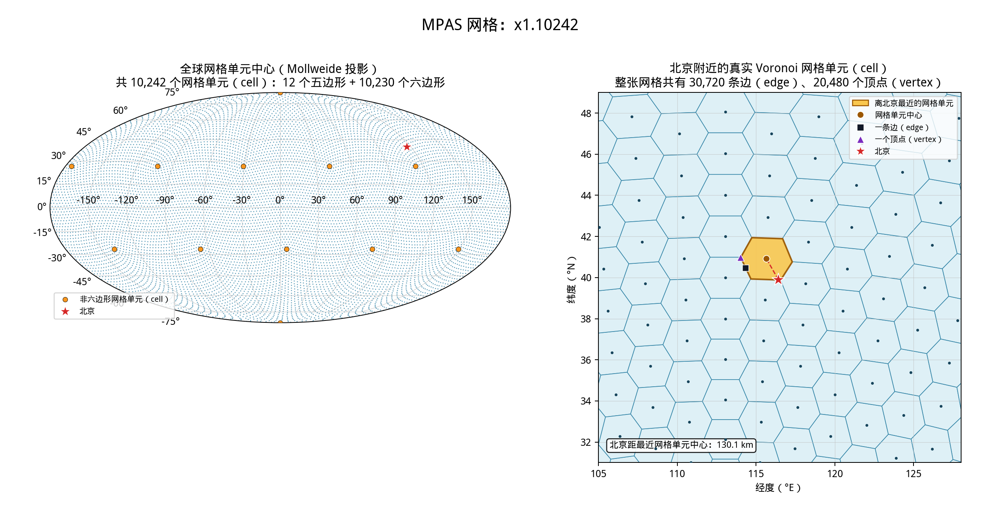
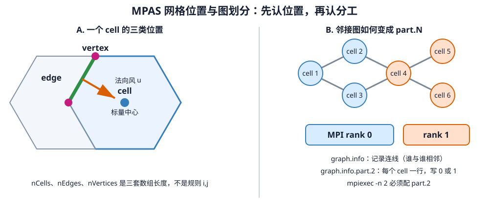

# 第 3 课：把 MPAS 的真实网格画出来

WRF 用户第一次看 MPAS 网格文件，最容易困惑的不是公式，而是找不到熟悉的
`west_east` 和 `south_north`。这一课就从一张真正的 240 km 教学网格入手：先下载，
再查看数组，最后把全球网格和北京附近的多边形画出来。

阅读本课只需完成第 1 课，不需要 WPS，也不需要下载 GFS。仓库已经附上网格图；如果要
亲自重画，还需要 Python 3、`venv`、`pip`，并且能够安装三个 Python 包。

## MPAS 怎样在球面上铺网格

MPAS 采用球面质心 Voronoi 剖分（SCVT）。可以先把它想成一只由多边形拼成的足球：
每个多边形区域叫网格单元（**cell**），两个网格单元共用的线段叫边（**edge**），几条边
相交的点叫顶点（**vertex**）。英文名必须认识，因为 NetCDF 变量名会直接使用它们。

| MPAS 中的位置 | 常见变量 | WRF 用户需要注意什么 |
|---|---|---|
| 网格单元（cell） | 温度、压力、水汽等标量 | 类似质量点，但没有规则的 `i,j` 下标 |
| 边（edge） | 穿过边的法向风速 | 每条边的朝向不同，不能简单理解成固定的东西风或南北风 |
| 顶点（vertex） | 涡度等顶点变量 | 不能用网格单元下标直接去取顶点变量 |

`nCells`、`nEdges`、`nVertices` 是三类位置各自的总数。`cellsOnCell` 一类变量记录谁与谁
相邻。WRF 的行列位置本来就藏在规则数组里；MPAS 没有规则行列，所以必须把相邻关系
明确写进文件。

## “北京为中心”不是 WRF 的 `ref_lat/ref_lon`

全球准均匀网格上，各处网格单元大小大致相同，不存在一个必须填写的中心点。变分辨率网格
才会在目标区域逐渐缩小网格单元。本教程选用的官方变分辨率网格有一个圆形加密区；MPAS
也允许设计多个加密区，或者使用非圆形的加密范围。

网格文件名说的是网格类型，并不是 WRF 那种“东西多少格、南北多少格”的写法：

- `x1.10242`：约 240 km 的准均匀网格，共有 10242 个网格单元；
- `x4.163842`：共有 163842 个网格单元，官方给出的最粗、最细尺度约为 92～25 km，相差
  大约四倍。

这里的公里数是当地网格间距的代表值，不代表整张网格处处都有完全相同的 `dx`。我们先用
`x1.10242` 跑通教学算例，第 8 课再把 `x4.163842` 原有的加密区移动到北京
`(39.9042°N, 116.4074°E)`。

## 先把 240 km 教学网格下载下来

在仓库根目录执行：

```bash
./prepare_beijing_case.sh --mesh-only
CASE="$PWD/work/beijing_240km_2026101500"
local/io-stack/bin/ncdump -h "$CASE/x1.10242.grid.nc" | \
  grep -E '^[[:space:]]*(nCells|nEdges|nVertices) =|^[[:space:]]*(double latCell|int cellsOnCell)\('
```

`--mesh-only` 表示只准备官方网格及配套的静态文件，跳过 GFS 链接和 `ungrib.exe`。

### 这一步留下了什么

脚本的终端摘要和 `ncdump` 的关键输出应当接近下面这样：

```text
Prepared mesh files in .../work/beijing_240km_2026101500
nCells = 10242 ;
nVertices = 20480 ;
nEdges = 30720 ;
double latCell(nCells) ;
int cellsOnCell(nCells, maxEdges) ;
```

案例目录中新增的不只是一个 NetCDF 文件，还包括原始邻接图和多种 MPI 进程数对应的分区：

```text
work/beijing_240km_2026101500/
├── x1.10242.grid.nc
├── x1.10242.static.nc
├── x1.10242.graph.info
├── x1.10242.graph.info.part.2
├── x1.10242.graph.info.part.4
├── ...
└── x1.10242.graph.info.part.64
```

第一次下载还会把两个压缩包留在缓存中，换案例或重装时可以复用：

```text
downloads/
├── x1.10242.tar.gz          # 约 6.1 MiB
└── x1.10242_static.tar.gz   # 约 5.5 MiB
```

`grid.nc` 的头部是 NetCDF CDL 描述，关键部分长这样：

```cdl
dimensions:
    nCells = 10242 ;
    nVertices = 20480 ;
    nEdges = 30720 ;
variables:
    double latCell(nCells) ;
        latCell:units = "rad" ;
    int cellsOnCell(nCells, maxEdges) ;
        cellsOnCell:long_name = "IDs of cells neighboring a cell" ;
```

下载包里的 `x1.10242.static.nc` 已经带有插值到这张网格上的地形、土地利用和土壤资料，
第 6 课才会使用它。下一步只读取 `grid.nc` 画图；若要移动加密中心，应使用第 8 课的网格
旋转工具，而不是逐项修改 NetCDF 中的 `latCell`。

## 再把刚下载的网格画出来

`ncdump` 能告诉我们数组是否存在，却不容易让人看出网格单元究竟长什么样。理解绘图过程
以前，先认清下面几组变量。这里必须把两个“顶点编号”分清：

- `lonCell/latCell`：每个网格单元中心的经纬度，文件中使用弧度；
- `nEdgesOnCell`：每个网格单元有几条边，也就有几个顶点；
- `verticesOnCell`：按网格单元边界顺序列出顶点，里面存的是**全局顶点编号**，不是
  `latVertex/lonVertex` 的数组下标；
- `indexToVertexID`：记录每个本地数组位置对应的全局顶点编号。要从
  `verticesOnCell` 找到顶点坐标，必须先把这张表反过来查，得到全局编号在
  `latVertex/lonVertex` 中的位置。本课的 `x1.10242` 文件恰好按 `1, 2, 3...` 排列，
  但别的网格未必如此，不能把全局编号减 1 后直接当作 Python 下标；
- `indexToCellID`：把网格单元的本地数组位置对应到全局编号。脚本用它报告离北京最近的
  网格单元编号。

下面这幅图不是手绘示意图，而是由刚才下载的 `x1.10242.grid.nc` 直接生成的。



先看左图。Mollweide 等积投影把全球球面展开成椭圆，所有网格单元中心近似均匀地覆盖
全球。这张网格没有 WRF 区域那样的矩形外边界。10242 个网格单元中，10230 个是六边形，
另外 12 个是闭合球面必需的五边形，图中用橙点标出。北京红星只标地理位置，不负责定义
网格。

再看右图。绘图脚本先把 `indexToVertexID` 反过来查，再把 `verticesOnCell` 中的全局
编号换成 `latVertex/lonVertex` 的数组位置，由此重建北京附近真实的 Voronoi 多边形。
浅蓝色区域是网格单元；棕点、黑方块和紫三角依次标出所选网格单元的中心、一条边和一个
顶点。北京虽然落在这个网格单元内，距离其中心却约有 130 km。这也说明 240 km 网格只
适合验证整套程序能否跑通，不适合城市尺度预报。

图中没有叠加海岸线、地形和天气场，这是有意为之。`grid.nc` 只描述网格几何；地形在
`static.nc` 中，起报天气状态则在 `init.nc` 中。把它们分开看，更容易知道每一步到底
产生了什么。

仓库里已经放好了上图。若想用自己的下载文件重新画一遍，可以建立一个专门用于绘图和
后处理的 Python 环境。它与 MPAS 的编译环境互不影响：

```bash
python3 -m venv work/venv-post
source work/venv-post/bin/activate
python -m pip install --upgrade pip
python -m pip install numpy netCDF4 matplotlib

python tools/plot_mpas_mesh.py \
  "$CASE/x1.10242.grid.nc" \
  --output "$CASE/x1.10242.mesh.png"
test -s "$CASE/x1.10242.mesh.png"
```

### 这一步留下了什么

第一次安装 Python 包时会有较长的下载与安装信息，末尾会出现类似下面一行；具体版本随
安装时间变化，重复执行时则会提示这些包已经存在：

```text
Successfully installed matplotlib-... netCDF4-... numpy-...
```

随后，绘图脚本会给出本课真实网格的摘要：

```text
mesh: 10242 cells, 30720 edges, 20480 vertices
cell shapes: 5 sides=12, 6 sides=10230
nearest target cell: index=3150, ID=3151, center=(115.6503 E, 40.9221 N), distance=130.1 km
wrote .../work/beijing_240km_2026101500/x1.10242.mesh.png
```

这一步新建 Python 虚拟环境和一张约 466 KiB 的 PNG：

```text
work/
├── venv-post/                       # numpy、netCDF4、matplotlib
└── beijing_240km_2026101500/
    └── x1.10242.mesh.png
```

最后一条 `test -s` 成功时没有输出，它只确认图片存在且不是空文件。想换图片位置就改
`--output`，想换目标点则使用脚本提供的经纬度参数。`work/venv-post/` 和 PNG 都是后处理
产物，不会改变模式网格。

Mollweide 只改变画图方式，不会改变模式网格。不要拿屏幕上的长度去量网格距。这张图也
只能证明网格几何能够正常读取，不能证明静态场、初值或预报已经生成。

## `graph.info.part.64` 到底是什么

现在网格已经看明白了，再来讲并行分区。非结构网格没有矩形行列，不能像规则网格那样
直接横切竖切。MPAS 会先把网格看成一张图：每个网格单元是一个图节点，两个单元相邻，
就在节点之间连一条图边。

- `x1.10242.graph.info` 保存整张网格单元邻接图。首行的 `10242 30720` 分别表示图节点数和
  图边数，后面每一行列出一个网格单元的邻居；
- `x1.10242.graph.info.part.64` 是 METIS 把上述图分成 64 份的结果。文件有 10242 行，
  每行对应一个网格单元，行内的整数 `0…63` 表示由哪个 MPI 进程负责这个单元；
- 文件名最后的 `N` 必须与 `mpiexec -n N` 完全相同。它表示 MPI 进程数，不是线程数，
  也不是网格分辨率。



用下面三条命令检查 64 进程分区文件：

```bash
head -n 1 "$CASE/x1.10242.graph.info"
wc -l "$CASE/x1.10242.graph.info.part.64"
awk 'NR==1{lo=hi=$1} {if($1<lo)lo=$1; if($1>hi)hi=$1} \
     END{print "rank range:",lo,hi}' "$CASE/x1.10242.graph.info.part.64"
```

### 这一步留下了什么

这三个命令不会创建新文件，只会读出下载包中的分区信息。本项目实测为：

```text
        10242        30720
10242 .../x1.10242.graph.info.part.64
rank range: 0 63
```

`graph.info` 本身是纯文本。第一行给出节点和图边数量，接下来的每一行列出一个 cell 的
邻居编号，例如：

```text
        10242        30720
     2567     2563     2564     2565     2566
     2570     2571     2572     2568     2569
```

`.part.64` 也是纯文本，但它每行只有一个 rank 编号；开头可能像这样：

```text
56
7
40
25
50
```

以后在 namelist 中看到

```fortran
config_block_decomp_file_prefix='x1.10242.graph.info.part.'
```

意思就是：MPAS 会把实际使用的 MPI 进程数接在这个前缀后面，再读取对应的分区文件。
要改的是 MPI 任务数，或 namelist 中指向另一套网格分区的前缀；不要手工重排 `.part.N`
中的数字。缺少某个任务数的分区文件时，应使用图划分工具重新生成，而不是复制后改文件名。

## 把加密区移到北京，究竟改了什么

`grid_rotate` 只能把一张已有的球面网格整体旋转，不能凭空生成网格单元。第 8 课会用它把
官方 `x4.163842` 网格的加密区从 `(0°,0°)` 转到北京。

旋转后，每个网格单元的经纬度、科氏参数和边的地理方向都会改变，但“哪些单元彼此
相邻”不会变，所以原有 `graph.info.part.N` 仍可使用。地形和土地利用取决于实际经纬度，
旋转后必须重新制作 `static.nc`。

全球网格没有侧边界。以后若把全球网格裁成有限区域，才需要准备侧边界条件（LBC）。
侧边界多久更新一次，由外部强迫资料和试验设置共同决定，并不是 MPAS 固定为三小时。

## 用自己的话讲一遍

1. `10242` 为什么不能理解成 `e_we × e_sn`？
2. `verticesOnCell` 中的全局编号怎样找到 `latVertex/lonVertex` 中的数组位置？
3. `.part.64` 的每一行代表什么，行内的数字又代表什么？
4. 为什么旋转网格后可以继续使用原分区文件，却必须重新制作静态场？
5. 为什么图中的北京红星不等于“网格中心”？

第 2 问最容易讲反。记住：NetCDF 文件里的 `verticesOnCell` 给出全局编号，坐标数组使用
本地位置，中间必须反查一次 `indexToVertexID`。

## 参考资料

- [MPAS-A 官方网格列表](https://www2.mmm.ucar.edu/projects/mpas/site/downloads/meshes.html)
- [官方网格旋转与图划分说明](https://www2.mmm.ucar.edu/projects/mpas/site/documentation/users_guide/preparing_meshes.html)
