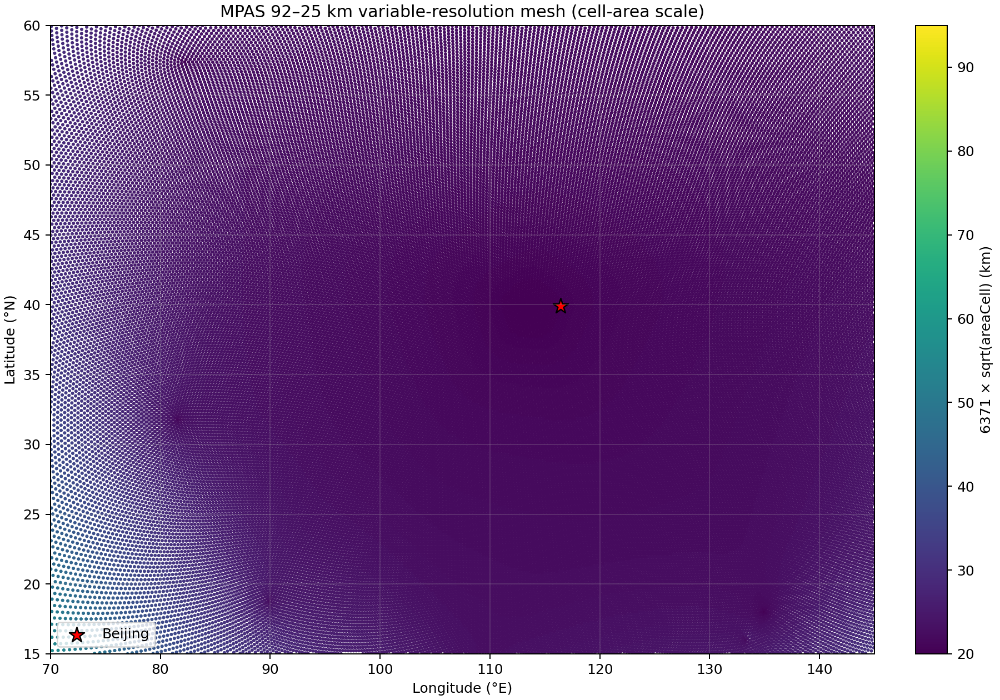

# 第 8 课：把变分辨率网格转到北京

熟悉 WRF 的人，设区域时先写 `ref_lat/ref_lon`、`dx/dy` 和 `e_we/e_sn`。
`namelist.atmosphere` 里没有一组能直接生成水平网格的参数。“以北京为中心”写在
模式运行之前。先准备一份已经写好多边形位置和连接关系的 `grid.nc`，再让 MPAS 读它。
一次真实资料预报要这三层文件。

```text
网格文件 grid.nc       多边形在哪里，哪些网格单元互为邻居
静态文件 static.nc     每个网格单元上的地形、土壤和土地利用是什么
初值文件 init.nc       起报时刻的风、温度、湿度、气压和陆面状态是什么
```

加密区一旦移动，地理位置就变了，因此静态文件和初值文件都必须重新制作。

## MPAS 网格从哪里来

常见有四条路。

1. 下载官方的准均匀全球网格。最省事，但没有所谓的“区域中心”；
2. 下载官方的全球变分辨率网格，再把加密区旋转到目标区域。本课采用这种办法；
3. 使用 MPAS-Tools 网格工具，其中会调用 JIGSAW 网格生成器，根据“各处希望使用多大
   分辨率”重新生成网格；
4. 从全球网格裁出有限区域，并另外制作随时间变化的侧边界条件。

第 3 课已经讲过球面质心 Voronoi 剖分（SCVT）。第一次接触 MPAS，不必从网格生成的
数学开始。先转一张官方检查过的网格，出了问题更容易分清是网格本身，还是气象资料初始化。

## 为什么先用 92–25 km 网格

官方 `x4.163842` 网格共有 163842 个网格单元：全球背景分辨率约 92 km，加密中心约 25 km，
加密区大约横跨 60°。名称中的 `x4` 表示粗区与细区的分辨率相差约四倍，`163842` 表示
全球网格单元总数，不是 WRF 中的 `e_we × e_sn`。

下图颜色使用 `6371 km × sqrt(areaCell)` 计算。它只根据单元面积估算局地尺度，并不等于
官方给出的严格名义网格间距。点越密、颜色越暗，说明当地网格单元越小。



## 第一步：下载网格并把加密区转到北京

第 1、2 课做完，并确认能用 `curl`、Git、Make 和项目自带的 netCDF。NumPy、
netCDF4、Matplotlib 已在第 7 课装进 `work/venv-post`，新终端先激活它。命令从仓库
根目录跑，会下载约 122 MiB 的压缩包，原网格和旋转后的网格都留在 `work/`。

```bash
source work/venv-post/bin/activate
./prepare_beijing_vr_mesh.sh
```

省掉编译器的逐行信息后，本机这一步留下这些。

```console
$ source work/venv-post/bin/activate
$ ./prepare_beijing_vr_mesh.sh
Using MPAS-Tools revision: be1954cf369ae0e3aad06cda7283a15f7cb1325e
...
nearest cell=151469, distance=10.256 km, area scale=20.28 km
Rotated mesh: .../work/beijing_92-25km/beijing.x4.163842.grid.nc
Graph partitions remain: .../work/beijing_92-25km/x4.163842.graph.info.part.*
```

这里的 `.../` 省略了因安装位置而异的仓库绝对路径，不代表相对路径或另一个文件。

第一次跑完，新文件落在四个地方。

```text
MPAS_tutorial/
├── downloads/x4.163842.tar.gz              # 官方压缩包，约 122 MiB
├── src/MPAS-Tools/                          # 固定版本的源码与编译结果
├── local/bin/grid_rotate                    # 网格旋转程序
└── work/beijing_92-25km/
    ├── x4.163842.grid.nc                    # 官方原始网格，约 214 MiB
    ├── x4.163842.graph.info                 # 邻接图
    ├── x4.163842.graph.info.part.*          # 官方分区文件
    ├── namelist.input                       # 本次旋转参数
    └── beijing.x4.163842.grid.nc            # 旋转后的网格，约 214 MiB
```

下载包和源码可以复用，`beijing.x4.163842.grid.nc` 才是本案例后续制作静态资料的网格输入。

脚本还会下载并编译 MPAS-Tools 中的 `grid_rotate` 网格旋转程序。默认使用 MPAS-Tools
2.1.0 的提交 `be1954cf369ae0e3aad06cda7283a15f7cb1325e`，运行时会打印实际提交号。这样
换一台机器重做，也不会因为主分支更新而得到另一套结果。只有确实需要试验其他版本时，
才覆盖默认版本。

```bash
./prepare_beijing_vr_mesh.sh --mpas-tools-revision TAG_OR_COMMIT
```

模式的 namelist 不参与这次旋转。`grid_rotate` 读的是当前工作目录里的 `namelist.input`。

```fortran
&input
 config_original_latitude_degrees = 0.0
 config_original_longitude_degrees = 0.0
 config_new_latitude_degrees = 39.9042
 config_new_longitude_degrees = 116.4074
 config_birdseye_rotation_counter_clockwise_degrees = 0.0
/
```

前两项指出原网格的加密中心在 `(0°, 0°)`；中间两项把这个中心移到北京；最后一项控制
以参考点为中心的逆时针旋转角度。圆形加密区设为 0 即可，非圆形加密区则可以用它调整
朝向。脚本不改原文件，结果写到这个路径。

```text
work/beijing_92-25km/beijing.x4.163842.grid.nc
```

脚本同时生成了下列关键配置。它由 `--latitude/--longitude` 参数写出，下次运行会覆盖；想
换加密中心应改命令参数，不要只手改这个临时文件后又重新运行脚本。

```console
$ sed -n '1,8p' work/beijing_92-25km/namelist.input
&input
 config_original_latitude_degrees = 0.0
 config_original_longitude_degrees = 0.0
 config_new_latitude_degrees = 39.9042
 config_new_longitude_degrees = 116.4074
 config_birdseye_rotation_counter_clockwise_degrees = 0.0
/
```

## 第二步：确认网格确实转到了北京

脚本结束时应打出最近网格单元的距离和面积尺度。本机是 10.256 km 和 20.28 km。

```text
nearest cell=..., distance=10.256 km, area scale=20.28 km
```

再检查网格维度，并画出局地分辨率分布。

```bash
local/io-stack/bin/ncdump -h work/beijing_92-25km/beijing.x4.163842.grid.nc \
  | grep -E 'nCells =|nEdges =|nVertices ='

python tools/plot_mesh_resolution.py \
  work/beijing_92-25km/beijing.x4.163842.grid.nc \
  --output work/beijing_92-25km/beijing_mesh_resolution.png
```

当前网格和图片的检查结果是这些。

```console
$ local/io-stack/bin/ncdump -h work/beijing_92-25km/beijing.x4.163842.grid.nc | grep -E 'nCells =|nEdges =|nVertices ='
nCells = 163842 ;
nVertices = 327680 ;
nEdges = 491520 ;

$ python tools/plot_mesh_resolution.py \
>   work/beijing_92-25km/beijing.x4.163842.grid.nc \
>   --output work/beijing_92-25km/beijing_mesh_resolution.png
selected 59042 of 163842 cells; wrote work/beijing_92-25km/beijing_mesh_resolution.png

$ ls -lh work/beijing_92-25km/{x4.163842.grid.nc,beijing.x4.163842.grid.nc,beijing_mesh_resolution.png}
-rw-r-----+ ... 214M ... beijing.x4.163842.grid.nc
-rw-rw----+ ... 2.1M ... beijing_mesh_resolution.png
-rw-r-----+ ... 214M ... x4.163842.grid.nc
```

原始网格、旋转网格和分辨率图分别是输入、核心派生数据和检查图。要换加密位置，就重新
运行旋转脚本；要换绘图范围，则使用 `plot_mesh_resolution.py --extent W E S N`。检查图中
暗色密集区围绕北京红色星号展开。色标表示面积尺度估算，地形和预报变量不在这张图上。

预期结果是 `nCells=163842`，最近的网格单元中心距北京约 10 km。按面积计算的当地尺度约 20 km。
网格名称里的 25 km 是名义网格间距，脚本使用的只是
`sqrt(areaCell)` 这一面积尺度估算。

## 网格转动以后，为什么分区文件还能用

可以把每个网格单元当作图中的一个节点，把两个相邻单元之间的关系当作连线。

- `x4.163842.graph.info` 保存所有网格单元的邻接关系；
- `x4.163842.graph.info.part.N` 把这些网格单元分给 `N` 个 MPI 进程；
- 文件名中的 `N` 必须和 `mpiexec -n N` 完全一致。

旋转网格会改变 `latCell/lonCell`、球面三维坐标、科氏参数以及边的地理方向，却没有
改变“谁和谁相邻”。原来的 `graph.info` 和 `.part.N` 因此仍可使用；原来的
`static.nc`、`init.nc` 和预报输出则与旧地理位置绑定，不能继续使用。

官方压缩包已经带有若干常用进程数的分区文件，先查看现有文件。

```bash
find work/beijing_92-25km -maxdepth 1 \
  -name 'x4.163842.graph.info.part.*' -printf '%f\n' | sort -V
```

当前压缩包实际带这些后缀。

```console
$ find work/beijing_92-25km -maxdepth 1 -name 'x4.163842.graph.info.part.*' -printf '%f\n' | sort -V
x4.163842.graph.info.part.12
x4.163842.graph.info.part.16
x4.163842.graph.info.part.24
x4.163842.graph.info.part.32
x4.163842.graph.info.part.48
x4.163842.graph.info.part.64
x4.163842.graph.info.part.96
x4.163842.graph.info.part.128
x4.163842.graph.info.part.192
x4.163842.graph.info.part.256
x4.163842.graph.info.part.384
x4.163842.graph.info.part.512
x4.163842.graph.info.part.768
x4.163842.graph.info.part.1024
```

可以选择列表中已有的任务数，但**不能把 `.part.64` 重命名成 `.part.96`**：文件内容本身
就是划分结果，不只是名字。需要新任务数时必须用 METIS 从 `graph.info` 重新划分。

只有所需进程数不在列表中时，才需要用 METIS 图划分软件重新生成。例如系统另行安装了
`gpmetis`，可用下面的命令制作当前压缩包没有的 20 进程分区。

```bash
command -v gpmetis
cd work/beijing_92-25km
gpmetis -minconn -contig -niter=200 x4.163842.graph.info 20
cd ../..
```

本仓库的安装脚本目前不安装 METIS，也不会默认提供 `gpmetis` 命令。

## 第三步：重新制作北京网格的静态文件

静态插值需要旋转后的网格和 WPS 地理资料。

```text
beijing.grid.nc + WPS_GEOG
              ↓ init_atmosphere_model（只用 1 个 MPI 进程）
beijing.static.nc
```

不要只看见共享资料的顶层目录就认为权限没问题。先看所需地形分块的索引能不能读。

```bash
GEOG_DIR="${GEOG_DIR:-/eds/shared/dm/WPS_GEOG}"
namei -l "$GEOG_DIR/topo_gmted2010_30s/index"
test -r "$GEOG_DIR/topo_gmted2010_30s/index"
```

索引能读，再跑静态场脚本，并做后面的检查。

```bash
GEOG_DIR="$GEOG_DIR" ./generate_beijing_vr_static.sh

LOG=work/beijing_92-25km/log.init_atmosphere.0000.out
STATIC=work/beijing_92-25km/beijing.x4.163842.static.nc
grep 'Finished running the init_atmosphere core' "$LOG"
grep -Eq 'Error messages[[:space:]]*=[[:space:]]*0' "$LOG"
grep -Eq 'Critical error messages[[:space:]]*=[[:space:]]*0' "$LOG"
test -s "$STATIC"
local/io-stack/bin/ncdump -h "$STATIC" | grep 'nCells = 163842'

python - <<'PY'
import numpy as np
from netCDF4 import Dataset

path = 'work/beijing_92-25km/beijing.x4.163842.static.nc'
with Dataset(path) as ds:
    assert len(ds.dimensions['nCells']) == 163842
    for name in ('ter', 'landmask', 'ivgtyp', 'isltyp'):
        values = np.ma.asarray(ds.variables[name][:])
        assert values.count() == values.size, f'{name} contains missing values'
        assert np.all(np.isfinite(values)), f'{name} contains non-finite values'
        print(name, values.min(), values.max())
PY
```

上面是权限恢复后应执行的验收。本机还没有跑出成功输出。当前实际停在读取权限预检。

```console
$ GEOG_DIR=/eds/shared/dm/WPS_GEOG ./generate_beijing_vr_static.sh
Cannot read /eds/shared/dm/WPS_GEOG/topo_gmted2010_30s/index; request WPS_GEOG ACL/group access
$ echo $?
1
```

目录现状清楚。旋转网格在，静态文件还没有。

```console
$ stat -c '%s bytes %n' work/beijing_92-25km/beijing.x4.163842.grid.nc
224139172 bytes work/beijing_92-25km/beijing.x4.163842.grid.nc

$ test -s work/beijing_92-25km/beijing.x4.163842.static.nc \
>   || echo 'MISSING: beijing.x4.163842.static.nc'
MISSING: beijing.x4.163842.static.nc
```

权限预检在写配置、启动 MPAS 之前就退出，因此这次不会生成 static 或新日志。当前目录中
若还能看到旧的 namelist、streams 和日志，它们来自先前尝试，不能当作成功标志。权限通过
后，脚本会重新生成配置。和地理资料、开关、文件名有关的几行是这些。

```text
config_geog_data_path = '/eds/shared/dm/WPS_GEOG/'
config_static_interp = true
config_vertical_grid = false
input  stream: beijing.x4.163842.grid.nc
output stream: beijing.x4.163842.static.nc
```

解决办法是请管理员授予目录进入和文件只读权限，或把 `GEOG_DIR` 指向一套完整、可读的
WPS_GEOG。确认 `index` 和数据分块都能读取后，再重新运行脚本。

这里抽查的 `ter`、`landmask`、`ivgtyp`、`isltyp`，分别代表地形、陆海掩膜、主要植被类型
和主要土壤类型。日志出现完成标志、普通错误数为 0、严重错误数为 0、网格单元数正确，而且
关键字段没有缺测和非有限值，才算真正成功。单看文件是否存在并不可靠，因为程序中途退出
也可能留下残缺文件。

静态插值必须串行运行。为控制这个 25 km 教学案例的取样量和运行时间，脚本把三个超采样
参数都明确设为 1。这只是教学设置，不代表所有网格都应该这样选。

- `config_supersample_factor`：用于 MODIS 卫星反照率资料，包括最大雪反照率和逐月反照率；
- `config_lu_supersample_factor`：用于土地利用分类；
- `config_30s_supersample_factor`：用于 30 秒地形、土壤分类和吸收光合有效辐射比例
  （FPAR）等资料。

“超采样”是指在高分辨率地理资料中多取一些子样本，它不会把 25 km 的动力网格变成
30 秒网格。MPAS 8.4.2 中，`config_supersample_factor` 默认是 3，另外两项默认是 1。
正式试验如果关注反照率或复杂下垫面，应比较较高取样因子对静态场和运行时间的影响，
不要直接照搬本例。

## 有了静态文件，还不能马上预报

目前的 `run_beijing_case.sh` 专门为 `x1.10242` 的 240 km 教学网格编写，不能直接拿来运行
这张北京 `x4.163842` 网格。权限问题解决后，还要完成下面几步。

1. 复用第 4 课制作的 `FILE:*` 气象中间文件，以北京 `static.nc` 为输入，生成新的
   `init.nc`；
2. 修改 `streams.init_atmosphere`，让输入和输出分别指向北京的静态文件和初值文件；
3. 选择现有的 `.part.N`，用相同数量的 MPI 进程做气象场插值和模式积分；
4. 根据最细网格设置 `namelist.atmosphere` 中的时间步长和混合尺度；
5. 修改 `streams.atmosphere`，指向北京初值文件，并设置所需输出间隔。

可先从下面这组模式参数起步。

```fortran
&nhyd_model
 config_dt = 150.0
 config_start_time = '2026-10-15_00:00:00'
 config_run_duration = '1_00:00:00'
 config_len_disp = 25000.0
/
&decomposition
 config_block_decomp_file_prefix = 'x4.163842.graph.info.part.'
/
```

“时间步秒数约为最细网格公里数的 5—6 倍”只能当作起始经验，输出间隔还必须能被时间步
整除。CFL（库朗数）反映一个时间步内信息能跨过多少个网格尺度，最终应结合 CFL、最大
风速和日志中的稳定性表现，决定是否缩短时间步。`config_len_disp` 应采用最细处的名义
间距 25 km，不能用全球背景区的 92 km。

计划中的 25 km 变分辨率教学试验，应先继续使用 `mesoscale_reference` 物理方案中的积云
参数化。地图看起来更细，并不等于深对流已经可以完全显式解析。

## 做完以后怎样验收

- 已生成包含 163842 个网格单元的北京旋转网格，最近单元中心距北京约 10 km；
- 能说清 `.part.N` 中的 `N` 为什么必须等于 MPI 进程数；
- 能说清为什么网格分区文件可以复用，而静态文件不能复用；
- 静态文件必须同时通过完成标志、零错误、`nCells=163842` 和关键字段检查；当前机器仍因
  共享资料权限未能通过这一关；
- 知道当前只完成了网格旋转，北京变分辨率初值和预报还没有完成。

## 合上教程，试着自己讲一遍

整张球面网格转一个角度以后，为什么每个多边形的邻居没变，地形和科氏参数却要重算？
加密区只占全球的一部分，为什么时间步仍看最细的网格？


## 参考资料

- [MPAS-A 官方网格列表](https://www2.mmm.ucar.edu/projects/mpas/site/downloads/meshes.html)
- [官方网格旋转与图划分说明](https://www2.mmm.ucar.edu/projects/mpas/site/documentation/users_guide/preparing_meshes.html)
- [官方初始化 namelist 参数](https://www2.mmm.ucar.edu/projects/mpas/site/documentation/users_guide/appA_init_namelist.html)
