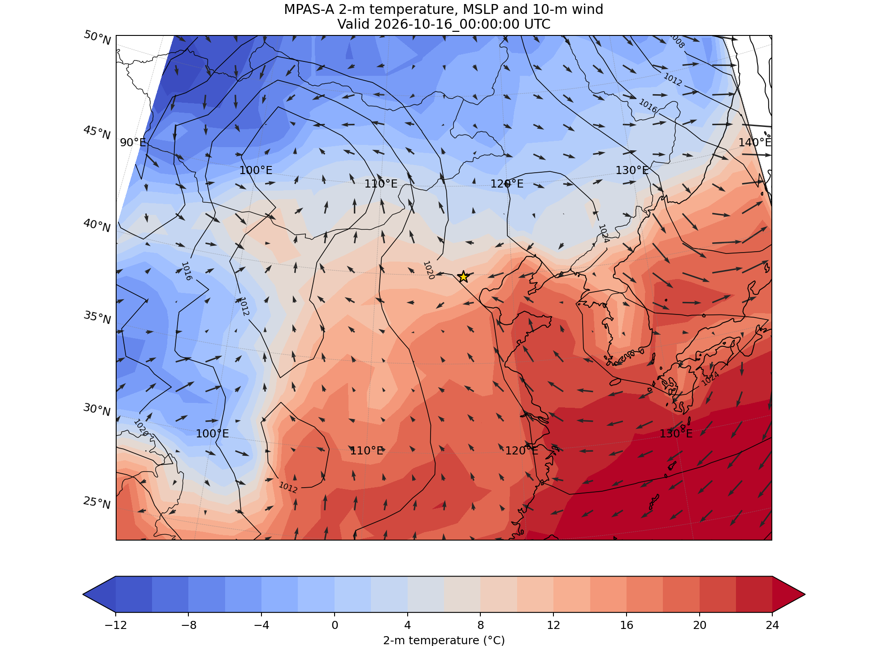

# 第 9 课：用 Cartopy 画出 240 km 预报

WRF 输出带有规则的二维下标，常用的画图程序可以直接沿着 `south_north` 和 `west_east`
铺开。MPAS 地面场却只有一列 `nCells`。怎样把这一列数值放回地图？画出来的连续色斑，
又有多少是模式真正算出的信息？这一课把这两件事讲清楚。

我们继续使用第 6 课已经跑通的 `x1.10242` 全球网格，名义分辨率约 240 km。第 8 课那张
北京 92—25 km 网格目前只完成了旋转；由于共享地理资料的读取权限尚未解决，它还没有
静态文件、初值和预报结果。先用来源明确的 240 km 结果练习绘图，可以把绘图问题与
初始化问题分开排查。



## 三个 Python 库各管一件事

这张图用到三个主要工具：netCDF4 从模式文件读取变量，Matplotlib 负责填色、等值线和
箭头，Cartopy 负责地图投影以及经纬度坐标转换。Cartopy 并不知道 MPAS 的网格单元、边、
顶点怎样连接，更不会自动把 `nCells` 变成 WRF 那样的二维数组。

本例的每个地面值都必须与相同下标的 `latCell/lonCell` 配对，才能知道它在地球上的位置。
这个对应关系一旦错了，程序仍可能画出一张“像天气图的图”，但地理位置全是错的。

## 第一步：在第 7 课的环境中安装 Cartopy

第 7 课已经在 Git 不跟踪的 `work/` 目录中创建了 Python 环境，并安装 NumPy、netCDF4
和 Matplotlib。现在从仓库根目录激活它，再增加地图投影库 Cartopy：

```bash
source work/venv-post/bin/activate
python -m pip install cartopy
python -c 'import numpy, netCDF4, matplotlib, cartopy; print(cartopy.__version__)'
```

如果你跳过了第 7 课，请先按第 7 课的步骤建立 `work/venv-post`。UXarray 是一个专门处理
非结构网格的可选 Python 库，本课脚本没有使用它，不必为了运行本例而安装。

Cartopy 第一次调用 50 m 分辨率的海岸线和国界时，可能会下载 Natural Earth 地图资料。
可用下面的命令查看缓存位置：

```bash
python - <<'PY'
import cartopy
print(cartopy.config['data_dir'])
PY
```

计算节点如果不能联网，应先在联网节点触发一次下载，再把缓存复制到计算节点能够读取的
目录。

## 第二步：先确认坐标和预报来自同一次试验

本例的诊断文件没有写入经纬度，因此脚本从 `init.nc` 读取坐标。只比较两个文件是否都有
10242 个网格单元还不够，因为两张不同网格也可能恰好拥有相同数量的单元。

MPAS 文件中的 `file_id` 是文件标识，`parent_id` 记录生成该文件时所依据的输入文件标识。
可以这样检查初值文件与诊断文件的生成关系：

```bash
python - <<'PY'
from netCDF4 import Dataset

coord = 'work/beijing_240km_2026101500/x1.10242.init.nc'
diag = 'work/beijing_240km_2026101500/diag.2026-10-16_00.00.00.nc'
with Dataset(coord) as grid, Dataset(diag) as data:
    assert len(grid.dimensions['nCells']) == len(data.dimensions['nCells'])
    assert grid.file_id in data.parent_id.splitlines()
    print('same source:', grid.file_id, 'nCells =', len(grid.dimensions['nCells']))
PY
```

这比只看文件名可靠。绘图脚本会自动再检查一次：只要文件带有这些标识却互不匹配，就会
立即停止。老文件若没有 `file_id/parent_id`，脚本会发出警告，只检查 `nCells`；此时还
应人工比较网格文件校验值。正式归档时，模式版本和配置文件也应一并保存。

## 第三步：画出 24 小时预报

```bash
python tools/plot_mpas_cartopy.py \
  work/beijing_240km_2026101500/x1.10242.init.nc \
  work/beijing_240km_2026101500/diag.2026-10-16_00.00.00.nc \
  --output work/beijing_240km_2026101500/cartopy_t2m.png

test -s work/beijing_240km_2026101500/cartopy_t2m.png
```

这张图对应世界协调时（UTC）2026-10-15 00 时起报后的第 24 小时，业务上常简写为 F024。
填色是 2 米温度，黑线是海平面气压，箭头是 10 米风，星号标出北京。脚本结束时会打印
选中的网格单元数量和图片路径。

请特别留意：240 km 网格在东亚范围内只有很少的网格单元。图面看起来平滑，是因为绘图
程序在离散点之间做了插值，并不表示模式突然拥有了更高的北京预报分辨率。

## 地图投影和数据坐标不是一回事

脚本中有两套坐标设置：

```python
import cartopy.crs as ccrs

data_crs = ccrs.PlateCarree()
projection = ccrs.LambertConformal(
    central_longitude=115,
    central_latitude=38,
)
```

`data_crs` 表示输入的 `lonCell/latCell` 是普通经纬度；`projection` 表示最后把地图画成
什么投影。向 `tricontourf`、`contour`、`quiver` 或 `scatter` 传入数据时，还要写
`transform=data_crs`，告诉 Cartopy 如何解释输入坐标。若省略这一项，Cartopy 可能把
经纬度数值当成 Lambert 投影平面上的坐标，图就会跑到错误位置。

这和 WRF 的 `map_proj=lambert` 不是一回事。MPAS 的动力过程始终在球面网格上计算，这里
选择 Lambert 只影响图片怎样显示，不会改变模式网格和计算结果。

## 连续色斑是怎样画出来的

脚本先选取东亚范围内的网格单元中心，再根据这些点的经纬度做 Delaunay 三角剖分，最后
用 `tricontourf` 在三角形上填色。所谓 Delaunay 三角剖分，就是只根据点的位置重新连接
三角形；它没有读取 MPAS 原生的 `verticesOnCell/cellsOnCell` 邻接关系。

这种方法适合快速查看区域天气形势，但也有明显局限：

1. 插值只让图片连续，不满足守恒，也没有增加任何模式信息；
2. 当前脚本在经纬度平面上做三角剖分，只适合本例这种不跨越日期变更线、也不靠近极区的
   区域；
3. 做面积积分、降水收支或模式间定量比较时，不能从插值后的图片反读数值。

不同目的应选不同办法：

- 快速看天气形势，可以画网格单元中心散点，或使用本课的 `tricontourf`；
- 展示原生网格，应按 `verticesOnCell` 画出 Voronoi 多边形；
- 与规则网格资料做定量比较，可用 ESMF、TempestRemap 等工具生成并保存重映射权重；
- 交互查看大型原生网格，可以继续学习 UXarray；
- 计算面积或水量收支，必须使用守恒重映射，并检查重映射前后的总量。

## 为什么图上的风可以直接画箭头

MPAS 三维模式变量 `u` 位于网格边上，只表示垂直于边的风速分量，不能直接当作地图上的
东西风和南北风。本课读取的是诊断文件中的 `u10/v10`：它们已经重建到网格单元中心，
并转换成地理坐标下的东西、南北分量。

等压面风也是同样道理。先用 `ncdump -h` 确认文件中确实有 `uzonal_*` 和
`umeridional_*`，不要凭印象猜变量名：

```bash
local/io-stack/bin/ncdump -h \
  work/beijing_240km_2026101500/diag.2026-10-16_00.00.00.nc \
  | grep -E 'u10|v10|uzonal|umeridional'
```

图中的 `10 m s⁻¹` 标尺给出了箭头长度参照。若需要精确风速，应直接读取变量，或查看第
7 课生成的 CSV，不能从已经投影、抽稀和缩放的箭头上反推数值。

## 做完以后怎样验收

- Python 环境能成功导入 NumPy、netCDF4、Matplotlib 和 Cartopy；
- `init.file_id` 出现在 `diag.parent_id` 中，而且两个文件的 `nCells` 相同；
- 成功生成非空的 `cartopy_t2m.png`，标题时刻为 2026-10-16 00 UTC；
- 能确认这张图来自 240 km 教学预报，不是北京 25 km 加密预报；
- 能解释为什么连续色斑不能拿来做守恒的降水收支计算。

## 合上教程，试着自己讲一遍

1. Cartopy 会不会负责把 `nCells` 变成规则二维数组？
2. `projection` 和 `transform` 分别说明什么？
3. 原始 `x4` 网格和旋转到北京的 `x4` 网格都有 163842 个网格单元，为什么不能混用坐标？
4. 240 km 网格画出的图片为什么会出现连续的小尺度色斑？

第 4 问若答不出来，就把原始散点和连续色斑放在一起看：中间多出来的细节来自绘图插值，
不是模式重新算了一遍天气。

## 延伸阅读

- [MPAS-A 官方可视化页面](https://www2.mmm.ucar.edu/projects/mpas/site/visualization.html)
- [MPAS-A 用户手册：Visualization](https://www2.mmm.ucar.edu/projects/mpas/site/documentation/users_guide/visualization.html)
- [官方 2025 实践教程](https://www2.mmm.ucar.edu/projects/mpas/tutorial/StAndrews2025/)
- [MPAS-Plotting Python 示例](https://github.com/mgduda/MPAS-Plotting)
