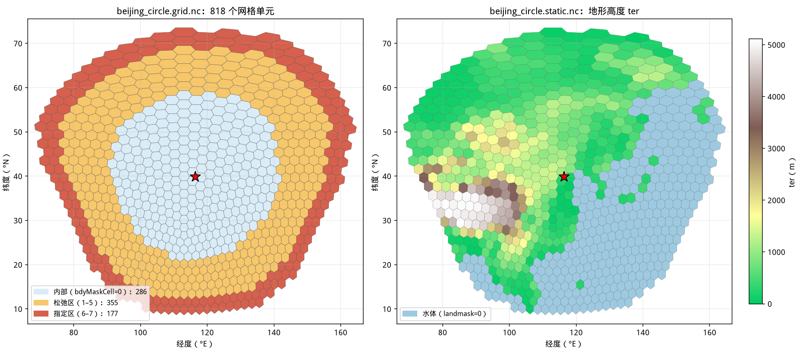
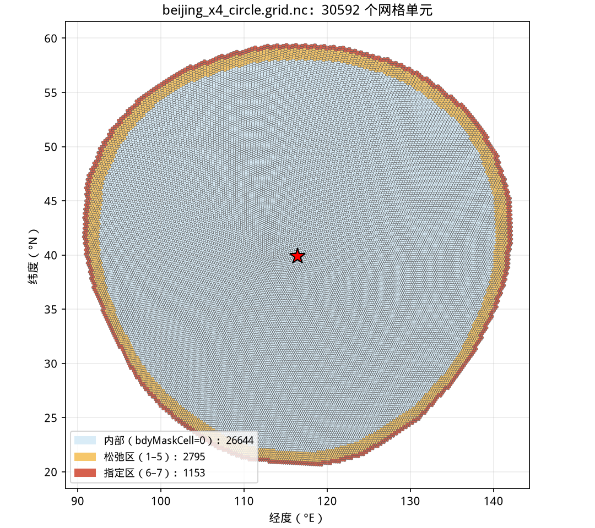
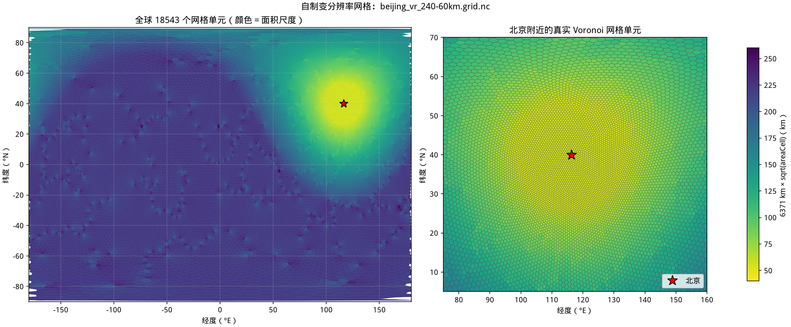

# 第 9 课：没有 Domain Wizard，MPAS 网格怎么选、怎么做

在 WRF 里划区域，很多人打开 Domain Wizard，在地图上拖一个矩形，软件写好
`ref_lat/ref_lon`、`dx` 和 `e_we/e_sn`。MPAS-A 没有这个窗口。区域写在文本里，
或者从现成的全球网格上裁。

后面按这个顺序写。

1. 有没有 Domain Wizard 一类的图形界面，区域靠什么文件划出来？
2. 官方网格、旋转、裁剪、完全自制，各在什么情况下用？
3. `create_region` 从全球网格裁北京区域时，圆的半径量到哪一圈？
4. 区域网格的侧边界（LBC）要改哪些开关？
5. 用 JIGSAW 和 MPAS-Tools 做变分辨率全球网格，交给 `init_atmosphere` 之前核哪些量？

命令都在本仓库这台服务器上跑过，输出摘自终端。240 km 区域网格做到了初值、侧边界
和 24 小时预报。从旋转网格裁出的区域，以及自制的变分辨率网格，只到网格文件和分区。
静态场要读 WPS_GEOG，下面会写明还差哪几步。

第 3 课的 `x1.10242` 和第 8 课把 92–25 km 网格转到北京，这里不再重讲。

## 先回答：有没有 MPAS 版的 Domain Wizard

目前没有官方图形界面。WRF Domain Wizard 是 WPS 的 Java 界面。WRF Configuration
Studio 是浏览器工具，也只面向 WRF。MPAS-A 官方给的是命令行工具。

| 需求 | 官方做法 | 本教程位置 |
|---|---|---|
| 全球准均匀网格 | 从官方网格页下载 `x1.*` | 第 3 课 |
| 全球变分辨率，加密区放到目标地 | 下载 `x4.*` 等网格，再用 `grid_rotate` 旋转 | 第 8 课 |
| 只算一块区域 | MPAS-Limited-Area 的 `create_region`，从任意全球网格裁剪 | 本课第一部分 |
| 加密区形状、大小都要自己定 | JIGSAW 生成网格；MPAS-Tools 提供 Python 封装 | 本课第二部分 |
| 中纬度矩形区域、六边形大小一致 | MPAS-Tools 的 `hex_projection`（兰伯特投影上的正六边形） | 本课不演示 |

UCAR 论坛上，开发人员对自定义区域网格的回答也是这条路。先下载全球网格，需要时旋转，
再用 MPAS-Limited-Area 裁。这个工具有 `-p/--plot`，只画边界、不裁网格。本课固定的
版本配 NumPy 2.5 时，这个选项会报错，记录在后面。检查裁剪结果时改用仓库里的绘图脚本。

MPAS 没有 `ref_lat`、格距和格点数这一组参数。区域形状写在 `.pts` 里，网格单元从现成的
全球网格里挑。疏密写成“各处希望多大网格”的函数，再交给网格生成器。

## 四条路线怎样选

选的时候我按这个顺序看。

1. 官方准均匀网格的分辨率够用，就下载，不用再做网格；
2. 需要局地加密，而且官方变分辨率网格的倍数和范围合适，用 `grid_rotate` 把加密区转过去
   （第 8 课）；
3. 只算一块区域，又有可靠的外部侧边界（例如 GFS），用 `create_region` 裁。源网格可以是
   准均匀的，也可以是转过的变分辨率网格；
4. 还不够，比如 60 km 收到 3 km、多个加密区，或者加密区不是圆，再自己生成。

官方网格已经被很多人用过。自制网格出问题，常要到 `init_atmosphere` 做静态场时才崩。
UCAR 论坛上已有用户报告自制 JIGSAW 网格在这一步出错，官方支持人员建议先退回
“旋转再裁剪”排查。

## 准备工具：Miniforge、MPAS-Tools 和 MPAS-Limited-Area

后面两部分都要用 Python 工具。`create_region` 只依赖 NumPy 和 netCDF4；自制网格还要用
JIGSAW 和 `jigsawpy`，以及 MPAS-Tools 中的 `MpasMeshConverter.x`，分区要用 METIS 的
`gpmetis`。这些在 conda-forge 上都有现成的包，所以本课用 Miniforge 安装，全部放在 Git 不
跟踪的 `local/` 和 `src/` 中，不影响第 7 课的 `work/venv-post`。

在仓库根目录装工具并激活环境。

```bash
./install_mesh_tools.sh
source local/miniforge3/etc/profile.d/conda.sh
conda activate mpas_mesh
```

脚本会下载 Miniforge 安装包，在 `local/miniforge3/envs/mpas_mesh` 中创建环境（固定
`mpas_tools=2.1.0`，与第 8 课 `grid_rotate` 用的 MPAS-Tools 版本一致），再把
MPAS-Limited-Area 和 NCAR 网格小课程的仓库检出到固定提交。

```console
$ ./install_mesh_tools.sh
...
Collecting package metadata (repodata.json): ...working... done
Solving environment: ...working... done
...
  added / updated specs:
    - cartopy
    - jigsawpy
    - matplotlib-base
    - metis
    - mpas_tools=2.1.0
    - nco
    - netcdf4
    - python=3.12
...
mpas_tools 2.1.0
jigsaw                 .../local/miniforge3/envs/mpas_mesh/bin/jigsaw
MpasMeshConverter.x    .../local/miniforge3/envs/mpas_mesh/bin/MpasMeshConverter.x
gpmetis                .../local/miniforge3/envs/mpas_mesh/bin/gpmetis
ncdump                 .../local/miniforge3/envs/mpas_mesh/bin/ncdump
MPAS-Limited-Area: edc556e174aee626bb8b54ec7f2ca00e05c501a1
mpas_jigsaw_tutorial: d5cd1c83112f14256883b24fe536dda2352e5005
Activate with: source .../local/miniforge3/etc/profile.d/conda.sh && conda activate mpas_mesh

$ du -sh local/miniforge3 downloads src/*
2.8G    local/miniforge3
121M    downloads
338K    src/MPAS-Limited-Area
192K    src/mpas_jigsaw_tutorial
```

这里的 `.../` 同样代表仓库所在的绝对路径。环境里共装了 196 个包。服务器第一次从
conda-forge 下载时很慢，曾在一个 Qt 包上卡住，后来把 `matplotlib` 换成不带图形界面的
`matplotlib-base`，包缓存好之后重新运行，整个脚本用时 136 s。网络不好时，第一次安装可能
要十几分钟甚至更久。

```text
MPAS_tutorial/
├── downloads/Miniforge3-Linux-x86_64.sh      # Miniforge 安装包，约 121 MiB
├── local/miniforge3/                          # conda 本体和包缓存，共约 2.8 GiB
│   └── envs/mpas_mesh/                        # 本课环境，约 1.4 GiB
└── src/
    ├── MPAS-Limited-Area/                     # create_region，固定提交 edc556e
    └── mpas_jigsaw_tutorial/                  # 培训课的网格检查脚本，固定提交 d5cd1c8
```

### 这一步留下了什么

`local/miniforge3/` 是独立的 conda，不会写入系统 Python，也不需要管理员权限。以后新开终
端，只要执行上面后两行即可。`mpas_jigsaw_tutorial` 是 2026 年 MPAS 培训“Generating
meshes for MPAS-Atmosphere”一课附带的仓库，本课只用其中的 `mesh_quality.py` 检查网格。想
换版本时，MPAS-Limited-Area 用 `--lam-revision`，培训课仓库用环境变量
`JIGSAW_TUT_REVISION` 覆盖默认提交，不要直接改 `src/` 中的文件。

## 第一部分：从全球网格裁出北京区域

### `.pts` 写区域的形状和名字

`create_region` 读两个输入。一个是描述区域形状的 `.pts`，一个是全球 MPAS 网格
（`grid.nc` 或 `static.nc`）。`.pts` 有四种写法。

| `Type:` | 需要的关键字 | 适合 |
|---|---|---|
| `circle` | `Point:` 圆心纬度、经度；`radius:` 半径（米） | 以城市为中心的区域 |
| `ellipse` | `Point:`；`Semi-major-axis:`、`Semi-minor-axis:`（米）；`Orientation-angle:`（从正北顺时针，度） | 东北—西南走向的雨带、山脉 |
| `custom` | `Point:` 区域内任一点；之后每行一个“纬度, 经度”顶点，逆时针排列 | 近似 WRF 矩形区域 |
| `channel` | `ulat:`、`llat:` 上下纬度 | 热带带状区域 |

`Name:` 决定输出文件名。从 `x1.10242.grid.nc` 裁得到 `Name.grid.nc`，从 `static.nc`
裁得到 `Name.static.nc`。经纬度顺序是纬度在前，和很多绘图库的 `(lon, lat)` 相反。

MPAS-Limited-Area 的说明写得很具体。从 `grid.nc` 裁时区域要是凸的，也不要在极区跨很大
经度，否则 `init_atmosphere` 插值静态场会出错。`channel` 最好只用于 `static.nc`。

### 裁出半径 2000 km 的北京圆形区域

`make_beijing_region.sh` 把写 `.pts` 和调用 `create_region` 放在一起，之后还会检查结果并
用 `gpmetis` 分区。默认从第 3 课的 `x1.10242.grid.nc` 裁剪，圆心是北京
`(39.9042°N, 116.4074°E)`，半径 2000 km。

```bash
./make_beijing_region.sh
ncdump -h work/beijing_region_240km/beijing_circle.grid.nc | \
  grep -E '^\s+(nCells|nEdges|nVertices) =|bdyMaskCell|sphere_radius'
head -n 1 work/beijing_region_240km/beijing_circle.graph.info
cat work/beijing_region_240km/beijing_circle.pts
```

```console
$ ./make_beijing_region.sh
Creating a regional mesh of  .../work/beijing_240km_2026101500/x1.10242.grid.nc
Marking boundary  1 ...
Filling region ...
Creating boundary layer: 1  ... 2  ... 3  ... 4  ... 5  ... 6  ... 7  ... 8  ... DONE!
...
Created a regional mesh:  beijing_circle.grid.nc
Creating graph partition file... beijing_circle.graph.info
beijing_circle.grid.nc: nCells=818, farthest cell center=3758 km
  bdyMaskCell=0:  286 cells,   130- 2116 km from center
  bdyMaskCell=1:   61 cells,  2118- 2341 km from center
  bdyMaskCell=2:   66 cells,  2345- 2574 km from center
  bdyMaskCell=3:   71 cells,  2552- 2808 km from center
  bdyMaskCell=4:   76 cells,  2749- 3044 km from center
  bdyMaskCell=5:   81 cells,  2943- 3281 km from center
  bdyMaskCell=6:   86 cells,  3138- 3519 km from center
  bdyMaskCell=7:   91 cells,  3333- 3758 km from center
Direct k-way Partitioning ---------------------------------------------------
 - Edgecut: 133, communication volume: 138.
  Partitioning:            0.002 sec   (METIS time)
Direct k-way Partitioning ---------------------------------------------------
 - Edgecut: 243, communication volume: 256.
  Partitioning:            0.003 sec   (METIS time)
Regional mesh: .../work/beijing_region_240km/beijing_circle.grid.nc

$ ncdump -h work/beijing_region_240km/beijing_circle.grid.nc | grep -E '^\s+(nCells|nEdges|nVertices) =|bdyMaskCell|sphere_radius'
        nCells = 818 ;
        nVertices = 1730 ;
        nEdges = 2547 ;
        int bdyMaskCell(nCells) ;
                :sphere_radius = 1. ;

$ head -n 1 work/beijing_region_240km/beijing_circle.graph.info
818 2360

$ cat work/beijing_region_240km/beijing_circle.pts
Name: beijing_circle
Type: circle
Point: 39.9042, 116.4074
radius: 2000000.0
```

中间省略的是 `create_region` 逐个复制变量的提示。整条命令用时 1.5 s。

```text
work/beijing_region_240km/
├── beijing_circle.pts                  # 区域说明，77 B
├── beijing_circle.grid.nc              # 区域网格，1.2 MiB
├── beijing_circle.graph.info           # 区域网格的邻接图，19 KiB
└── beijing_circle.graph.info.part.4/8  # 4 进程、8 进程分区，各 1.6 KiB
```

### 这一步留下了什么

`beijing_circle.pts` 是输入，想改中心或半径，应该改脚本参数
`--latitude/--longitude/--radius-km` 后重跑，不要只改这个文件。`beijing_circle.grid.nc`
是新的区域网格，`beijing_circle.graph.info` 是它自己的邻接图；全球网格自带的
`x1.10242.graph.info.part.*` 不能拿来用，因为网格单元编号已经重新排过。`.part.4`、
`.part.8` 是 `gpmetis` 按 4 个和 8 个 MPI 进程分好的结果，需要别的进程数时用 `--ntasks`
再生成。

半径要单独看。`.pts` 里写的是 2000 km，`bdyMaskCell=0` 的内部网格单元到 2116 km
为止。`create_region` 又在圆外加了 7 圈边界网格单元，最外圈离北京 3758 km。
MPAS-A 源码 `mpas_atm_boundaries.F` 里 `nRelaxZone = 5`、`nSpecZone = 2`，所以
1–5 是松弛区，6–7 是指定区。240 km 网格每一圈约 240 km，7 圈多出 1600 多公里。
换成 3 km 网格，同样 7 圈只多出约 20 km。设计半径时，让关心的范围落在
`bdyMaskCell=0` 里，并且离松弛区还有一段距离。



左图浅蓝是内部，橙色是松弛区，红色是指定区。右图是下一步从官方 `x1.10242.static.nc` 直接
裁出的地形高度，海洋用浅蓝色单独标出。图由新脚本 `tools/plot_region_mesh.py` 画出，每个
多边形都由 `verticesOnCell` 重建，与第 3 课的绘图方法相同。

### 直接裁 `static.nc`，绕过 WPS_GEOG

`create_region` 也能裁剪官方静态文件。这样得到的区域 `static.nc` 已经带有地形和土地利
用，也有土壤和重力波拖曳参数，不必再读 WPS_GEOG。对本仓库来说这一点很实用，因为第 8 课提
到的共享 WPS_GEOG 读取权限至今仍未解决。

```bash
./make_beijing_region.sh \
  --source work/beijing_240km_2026101500/x1.10242.static.nc --ntasks 4
ncdump -h work/beijing_region_240km/beijing_circle.static.nc | \
  grep -E 'float ter|int landmask|var2d\(|sphere_radius'
python tools/plot_region_mesh.py work/beijing_region_240km/beijing_circle.grid.nc \
  --static work/beijing_region_240km/beijing_circle.static.nc \
  --output work/beijing_region_240km/beijing_circle_region.png
python tools/plot_mpas_mesh.py work/beijing_region_240km/beijing_circle.grid.nc \
  --output work/beijing_region_240km/beijing_circle.mesh.png --zoom-extent 75 160 5 70
```

```console
$ ./make_beijing_region.sh --source work/beijing_240km_2026101500/x1.10242.static.nc --ntasks 4
...
Copying variable ter...
Copying variable landmask...
...
Created a regional mesh:  beijing_circle.static.nc
Creating graph partition file... beijing_circle.graph.info
beijing_circle.static.nc: nCells=818, farthest cell center=3758 km
...
Regional mesh: .../work/beijing_region_240km/beijing_circle.static.nc

$ ncdump -h work/beijing_region_240km/beijing_circle.static.nc | grep -E 'float ter|int landmask|var2d\(|sphere_radius'
        float ter(nCells) ;
        int landmask(nCells) ;
        float var2d(nCells) ;
                :sphere_radius = 6371229.f ;

$ python tools/plot_region_mesh.py work/beijing_region_240km/beijing_circle.grid.nc \
>   --static work/beijing_region_240km/beijing_circle.static.nc \
>   --output work/beijing_region_240km/beijing_circle_region.png
cells: 818; interior=286, relaxation=355, specified=177
wrote work/beijing_region_240km/beijing_circle_region.png

$ python tools/plot_mpas_mesh.py work/beijing_region_240km/beijing_circle.grid.nc \
>   --output work/beijing_region_240km/beijing_circle.mesh.png --zoom-extent 75 160 5 70
mesh: 818 cells, 2547 edges, 1730 vertices
cell shapes: 5 sides=1, 6 sides=817
nearest target cell: index=242, ID=243, center=(115.6503 E, 40.9221 N), distance=130.1 km
wrote work/beijing_region_240km/beijing_circle.mesh.png
```

裁剪静态文件用时 1.6 s，`bdyMaskCell` 各圈的个数和距离与上一步完全相同，这里省略。

```text
work/beijing_region_240km/
├── beijing_circle.static.nc            # 区域静态场，1.6 MiB
├── beijing_circle_region.png           # 分区和地形检查图，667 KiB
└── beijing_circle.mesh.png             # 第 3 课脚本画的网格图，703 KiB
```

### 这一步留下了什么

`beijing_circle.static.nc` 和 `beijing_circle.grid.nc` 的网格单元一一对应，`graph.info`
也完全相同，所以脚本只是重写了同一个文件。两张 PNG 是检查图，不参与计算。第 3 课的
`plot_mpas_mesh.py` 不改一行也能读区域网格：818 个网格单元里只剩 1 个五边形，最近网格单
元离北京仍是 130.1 km，与全球网格相同，说明裁剪没有移动网格单元。

注意两个文件的 `sphere_radius` 不同。`grid.nc` 是 1，表示坐标、距离和面积都在单位球上；
`static.nc` 是 6371229，因为 `init_atmosphere` 制作静态场时已经把它们乘上了地球半径。后
面自制网格时还会遇到这个区别。

这样裁出的静态场只能用于 240 km 区域。想要更细的区域，需要先有更细的全球静态文件，或者先
解决 WPS_GEOG 权限。

### 椭圆和多边形

`configs/regions/` 中另外放了一个椭圆和一个四边形示例，可以直接交给 `create_region`。

```bash
mkdir -p work/region_shapes && cd work/region_shapes
for shape in ellipse polygon; do
  python ../../src/MPAS-Limited-Area/create_region \
    ../../configs/regions/beijing_$shape.pts \
    ../beijing_240km_2026101500/x1.10242.grid.nc | grep 'Created a regional mesh'
  ncdump -h beijing_$shape.grid.nc | grep 'nCells ='
done
cd ../..
```

```console
$ mkdir -p work/region_shapes && cd work/region_shapes
$ for shape in ellipse polygon; do
>   python ../../src/MPAS-Limited-Area/create_region \
>     ../../configs/regions/beijing_$shape.pts \
>     ../beijing_240km_2026101500/x1.10242.grid.nc | grep 'Created a regional mesh'
>   ncdump -h beijing_$shape.grid.nc | grep 'nCells ='
> done
Created a regional mesh:  beijing_ellipse.grid.nc
        nCells = 826 ;
Created a regional mesh:  beijing_polygon.grid.nc
        nCells = 834 ;
$ cd ../..
```

两张网格一共用时 1.1 s。

```text
configs/regions/
├── beijing_circle.pts       # 与脚本默认值相同的圆
├── beijing_ellipse.pts      # 长半轴 2500 km、短半轴 1500 km，长轴从正北顺时针转 60°
└── beijing_polygon.pts      # 25–55°N、95–135°E 的四边形
work/region_shapes/
├── beijing_ellipse.grid.nc  beijing_ellipse.graph.info
└── beijing_polygon.grid.nc  beijing_polygon.graph.info
```

### 这一步留下了什么

两个 `.pts` 是版本库中的配置，`work/region_shapes/` 下是生成的网格和邻接图，这里没有分
区。四边形的顶点按逆时针排列：`(55,95)` 到 `(25,95)`，再到 `(25,135)` 和 `(55,135)`。想
要一个类似 WRF 的矩形区域，可以从这个文件改起，但要记住球面上“纬度、经度相等的四边形”并
不是等面积的矩形，高纬度一侧会更窄。

`-p` 预览选项在本课的环境中会失败。

```console
$ cd work/region_shapes
$ MPLBACKEND=Agg python ../../src/MPAS-Limited-Area/create_region -p ../../configs/regions/beijing_polygon.pts 2>&1 | tail -n 3
  File ".../local/miniforge3/envs/mpas_mesh/lib/python3.12/site-packages/numpy/_core/numeric.py", line 1680, in cross
    raise ValueError(
ValueError: Both input arrays must be (arrays of) 3-dimensional vectors, but they are 2 and 2 dimensional instead.
$ cd ../..
```

这是 `np.cross` 在 NumPy 2.0 以后不再接受二维向量造成的，属于 MPAS-Limited-Area 绘图代码
的兼容问题，裁剪本身不受影响。

### 从第 8 课的旋转网格中裁剪

官方更推荐的“局地加密 + 区域”做法，是先用 `grid_rotate` 旋转变分辨率网格，再用
`create_region` 裁剪。第 8 课已经得到 `beijing.x4.163842.grid.nc`，同一个脚本可以直接
用。

```bash
./make_beijing_region.sh \
  --source work/beijing_92-25km/beijing.x4.163842.grid.nc \
  --case-dir work/beijing_region_x4 --name beijing_x4_circle --ntasks "16 64"
python tools/plot_region_mesh.py work/beijing_region_x4/beijing_x4_circle.grid.nc \
  --output work/beijing_region_x4/beijing_x4_circle_region.png
```

```console
$ ./make_beijing_region.sh \
>   --source work/beijing_92-25km/beijing.x4.163842.grid.nc \
>   --case-dir work/beijing_region_x4 --name beijing_x4_circle --ntasks "16 64"
...
Created a regional mesh:  beijing_x4_circle.grid.nc
Creating graph partition file... beijing_x4_circle.graph.info
beijing_x4_circle.grid.nc: nCells=30592, farthest cell center=2183 km
  bdyMaskCell=0: 26644 cells,    10- 2018 km from center
  bdyMaskCell=1:  549 cells,  2000- 2041 km from center
  bdyMaskCell=2:  554 cells,  2023- 2064 km from center
  bdyMaskCell=3:  559 cells,  2043- 2087 km from center
  bdyMaskCell=4:  564 cells,  2064- 2111 km from center
  bdyMaskCell=5:  569 cells,  2084- 2135 km from center
  bdyMaskCell=6:  574 cells,  2105- 2159 km from center
  bdyMaskCell=7:  579 cells,  2125- 2183 km from center
Direct k-way Partitioning ---------------------------------------------------
 - Edgecut: 2465, communication volume: 2499.
  Partitioning:            0.023 sec   (METIS time)
Direct k-way Partitioning ---------------------------------------------------
 - Edgecut: 5387, communication volume: 5553.
  Partitioning:            0.054 sec   (METIS time)
Regional mesh: work/beijing_region_x4/beijing_x4_circle.grid.nc

$ python tools/plot_region_mesh.py work/beijing_region_x4/beijing_x4_circle.grid.nc \
>   --output work/beijing_region_x4/beijing_x4_circle_region.png
cells: 30592; interior=26644, relaxation=2795, specified=1153
wrote work/beijing_region_x4/beijing_x4_circle_region.png
```

读入 214 MiB 的旋转网格再裁剪，用时 9.4 s。

```text
work/beijing_region_x4/
├── beijing_x4_circle.pts                     # 80 B
├── beijing_x4_circle.grid.nc                 # 41 MiB
├── beijing_x4_circle.graph.info              # 1.1 MiB
├── beijing_x4_circle.graph.info.part.16/64   # 71 KiB、85 KiB
└── beijing_x4_circle_region.png              # 1.1 MiB
```

### 这一步留下了什么

同样是半径 2000 km 的圆，这次的结果差别很大。内部区有 26644 个网格单元，最外圈离北京只有
2183 km。7 圈边界一共只多出约 170 km，每圈约 24 km，与加密区的网格大小相当。整个区域
30592 个网格单元，不到全球 163842 个网格单元的 19%。



这是区域模拟常用的组合：加密区放在目标地，再沿着加密区边缘裁掉粗网格部分。这张网格还没有
静态文件。官方没有提供旋转后的 `static.nc`，要从 WPS_GEOG 重新制作，所以这里只做到网格和
分区。

### 用区域网格跑 24 小时预报

有了区域网格，还不能像全球那样只做一个 `init.nc` 就开始积分。MPAS-A 用户指南第 8.2 节列
出了区域模拟与全球模拟的三处不同。

1. 制作初值时，在 `namelist.init_atmosphere` 中设 `config_blend_bdy_terrain = true`，让
   边界附近的模式地形与驱动资料的地形混合；
2. 再运行一次 `init_atmosphere_model`，设 `config_init_case = 9`，用 `config_start_time`
   到 `config_stop_time` 之间的 `FILE:*` 生成一组 `lbc.*.nc`。`streams.init_atmosphere`
   中 `lbc` 流的 `output_interval` 必须等于 `config_fg_interval`；`input` 流要读带垂直网
   格的文件，通常就是刚做好的 `init.nc`；
3. 积分时在 `namelist.atmosphere` 中设 `&limited_area config_apply_lbcs = true`（全球模
   拟必须为 false），并让 `streams.atmosphere` 中 `lbc_in` 流的 `input_interval` 与 LBC
   文件间隔一致。

```fortran
&limited_area
 config_apply_lbcs = true
/
```

第 4 课的 `FILE:*` 间隔是 3 小时，正好对应 `config_fg_interval = 10800` 和
`input_interval="3:00:00"`。这和 WRF 的 `wrfbdy_d01` 作用相同，只是 MPAS 每个时次写一个
文件。

`run_beijing_case.sh` 只支持全球 `x1.10242`，所以本课另写了
`run_beijing_region_case.sh`。它沿用第 4 至 6 课全球案例目录中的 `FILE:*`、
`namelist.init_atmosphere` 和 `namelist.atmosphere`，只用 `sed` 改上面三处设置和分区文件
前缀，静态场直接用上一步裁出的 `beijing_circle.static.nc`，所以全程不读 WPS_GEOG。默认用
4 个 MPI 进程，从 2026-10-15 00 UTC 积分 24 小时。

```bash
./run_beijing_region_case.sh init
./run_beijing_region_case.sh lbc
grep -E 'Blending|total time  ' work/beijing_region_240km_run/log.init_case7.out | head -n 2
./run_beijing_region_case.sh run
grep -E 'config_apply_lbcs|Input interval for|Updated lateral' \
  work/beijing_region_240km_run/log.forecast.out | sort | uniq -c
grep -h WARNING work/beijing_region_240km_run/log.forecast.out | sort | uniq -c
```

```console
$ ./run_beijing_region_case.sh init
    Error messages =                     0
    Critical error messages =            0
-rw-r-----+ ... 15M ... beijing_circle.init.nc

$ ./run_beijing_region_case.sh lbc
    Error messages =                     0
    Critical error messages =            0
lbc.2026-10-15_00.00.00.nc
lbc.2026-10-15_03.00.00.nc
lbc.2026-10-15_06.00.00.nc
lbc.2026-10-15_09.00.00.nc
lbc.2026-10-15_12.00.00.nc
lbc.2026-10-15_15.00.00.nc
lbc.2026-10-15_18.00.00.nc
lbc.2026-10-15_21.00.00.nc
lbc.2026-10-16_00.00.00.nc

$ grep -E 'Blending|total time  ' work/beijing_region_240km_run/log.init_case7.out | head -n 2
 Blending first-guess terrain field along domain boundary
  1 total time                                           8.19684         1        8.19675        8.19684        8.19681   100.00       0.00       1.00

$ ./run_beijing_region_case.sh run
    Error messages =                     0
    Critical error messages =            0
diag.2026-10-15_00.00.00.nc
...
diag.2026-10-16_00.00.00.nc
history.2026-10-15_00.00.00.nc
...
history.2026-10-16_00.00.00.nc

$ grep -E 'config_apply_lbcs|Input interval for|Updated lateral' \
>   work/beijing_region_240km_run/log.forecast.out | sort | uniq -c
      1   - Input interval for 'lbc_in' stream = '0000000000_003:000:000'
      1   - config_apply_lbcs = T
      8  Updated lateral boundary conditions. LBCs are now valid

$ grep -h WARNING work/beijing_region_240km_run/log.forecast.out | sort | uniq -c
      9 WARNING: Variable lbc_qg not in input file.
      9 WARNING: Variable lbc_qi not in input file.
      9 WARNING: Variable lbc_qs not in input file.
      1 WARNING: Variable qg not in input file.
      1 WARNING: Variable qi not in input file.
      1 WARNING: Variable qs not in input file.
```

上面省略了每个 MPI 进程打印的 `IEEE_DENORMAL` 浮点提示，以及 Open MPI 在本服务器上的一行
`PMIX ERROR: NO-PERMISSIONS` 提示，三个阶段都照常结束。三步分别用时 8.9 s、33.2 s 和
29.8 s。预报日志中 `time integration` 共 72 次，即 `config_dt = 1200` s 积分 24 小时，计
时 20.1 s。

新增的文件都在一个目录里。

```text
work/beijing_region_240km_run/
├── beijing_circle.static.nc -> ../beijing_region_240km/beijing_circle.static.nc
├── beijing_circle.init.nc              # 区域初值，15 MiB
├── lbc.2026-10-15_00.00.00.nc ...      # 9 个侧边界文件，每个 3.2 MiB
├── log.init_case7.out  log.init_case9.out  log.forecast.out
├── diag.*.nc                           # 每 3 小时，每个 849 KiB
├── history.*.nc                        # 每 6 小时，每个 14 MiB
└── restart.2026-10-16_00.00.00.nc      # 35 MiB
```

整个目录 153 MiB。

### 这一步留下了什么

`log.init_case7.out` 中的 `Blending first-guess terrain field along domain boundary` 说
明地形混合确实打开了。`lbc.*.nc` 从 00 UTC 到次日 00 UTC 共 9 个，`nCells = 818` 与区域
网格一致，里面有 `lbc_u`、`lbc_w`、`lbc_theta`、`lbc_rho`、`lbc_qv`、`lbc_qc`、
`lbc_qr`。预报日志先确认 `config_apply_lbcs = T` 和 3 小时的 `lbc_in` 间隔，之后每 3 小
时更新一次侧边界，24 小时共 8 次。

30 条警告都是冰相水物质。`init_atmosphere` 从第 4 课的资料只写出 `qv`、`qc` 和 `qr`，所
以 LBC 文件里没有 `lbc_qi`、`lbc_qs`、`lbc_qg`。全球案例的 `x1.10242.init.nc` 同样只有这
三种水物质，全球预报日志里也有那 3 条 `qi/qs/qg` 警告，所以这些警告与区域设置无关。

### 和全球案例对照

再拿全球案例同一时刻的 `diag` 对照。区域网格的单元编号已经重排，新脚本
`tools/compare_region_global.py` 按网格中心坐标逐个匹配。

```bash
for t in 2026-10-15_12 2026-10-16_00; do
  echo "== $t"
  python tools/compare_region_global.py \
    work/beijing_region_240km/beijing_circle.grid.nc \
    work/beijing_240km_2026101500/x1.10242.grid.nc \
    work/beijing_region_240km_run/diag.$t.00.00.nc \
    work/beijing_240km_2026101500/diag.$t.00.00.nc
done
```

```console
== 2026-10-15_12
matched 818 cells, max centre offset 0.000 km
t2m [K]: NaN 0, nearest cell region 284.14 global 284.12; |region-global| interior mean 0.18 max 2.75, specified zone mean 1.22
mslp [hPa]: NaN 0, nearest cell region 1018.37 global 1018.08; |region-global| interior mean 0.36 max 1.71, specified zone mean 1.23
== 2026-10-16_00
matched 818 cells, max centre offset 0.000 km
t2m [K]: NaN 0, nearest cell region 280.81 global 280.82; |region-global| interior mean 0.31 max 5.75, specified zone mean 1.56
mslp [hPa]: NaN 0, nearest cell region 1021.54 global 1020.83; |region-global| interior mean 0.90 max 5.02, specified zone mean 1.48
```

这个脚本只读文件、打印结果，不产生新文件。

### 这一步留下了什么

`max centre offset 0.000 km` 说明区域网格的每个单元都能在全球网格中找到同一个中心。北京
最近的网格单元上，24 小时后区域和全球的 2 m 温度只差 0.01 K，海平面气压差 0.71 hPa。内部
区平均差 0.31 K 和 0.90 hPa，指定区平均差更大，因为那里每 3 小时被拉回 GFS 资料，而全球
案例是模式自己算出来的。两者不会完全相同，内部区个别网格单元的差值到了 5 K 以上，这次对
照没有去找它们的位置。

这样的对照只能说明区域设置没有明显错误，不能说明区域预报更好。240 km 的区域网格只适合练
习流程；正式试验应该换成上一节那样的变分辨率区域网格，再从 WPS_GEOG 制作静态场。

## 第二部分：自己生成一张变分辨率全球网格

### 先想清楚：我们要描述的是“网格大小函数”

JIGSAW 不认“北京”或“加密区”。它要的是一个函数，地球上每个位置希望多大的网格。
本课用 NCAR 培训课里最简单的圆形加密，按到北京的大圆距离 `r` 分三段。

```text
r < 1500 km             60 km
1500 km ≤ r < 7500 km   60 km 线性增加到 240 km
r ≥ 7500 km             240 km
```

过渡段宽 6000 km，网格大小每走 1 km 增加 `(240 − 60) / 6000 = 0.03` km。培训课建议这个斜
率控制在百分之几以内，并说 0.03 通常是安全的。我们故意把背景设成 240 km，是为了让网格在
普通机器上几秒钟就能生成。培训课还建议加密区直径最好有几百个网格单元；本例 60 km 区域直
径 3000 km，只有约 50 个网格单元，只能用来学习流程，不适合作为正式试验网格。

`tools/make_custom_mesh.py` 把这个函数取样到 0.5° 的经纬网格上，交给
`mpas_tools.mesh.creation.build_spherical_mesh`。后者先调用 JIGSAW 生成三角网，再用
`jigsaw_to_netcdf` 转换格式，最后由 `MpasMeshConverter.x` 生成 MPAS 网格和
`graph.info`。

### 生成网格并转换成 MPAS-A 格式

```bash
python tools/make_custom_mesh.py
ls -lh work/beijing_vr_240-60km
```

JIGSAW 会打印很长的日志，下面省略了配置清单和中间的迭代表。

```console
$ python tools/make_custom_mesh.py
target: (39.9042, 116.4074), 60 km within 1500 km, 240 km beyond 7500 km, transition slope 0.030
Step 1. Generate mesh with JIGSAW
Running: jigsaw mesh.jig
...
  JIGSAW VERSION 0.9.14
...
  HFUN data summary...

  ELLIPSOID-GRID

  .MIN(H). = 6.00e+01
  .MAX(H). = 2.40e+02

  |XGRID.| = 721
  |YGRID.| = 361
...
Step 2. Convert triangles from jigsaw format to netcdf
Step 3. Convert from triangles to MPAS mesh
Running: MpasMeshConverter.x mesh_triangles.nc base_mesh.nc
...
Built 18543 cells.
Built 37082 vertices.
...
Built 55623 edge indices...
...
     Found 0 incomplete cells. Each is marked with an area of -1.
...
        Mesh contains: 0 obtuse triangles.
...
build_spherical_mesh: 7.5 s
base_mesh.nc sphere_radius = 6371229.0 m -> beijing_vr_240-60km.grid.nc sphere_radius = 1.0
mesh: 18543 cells, 55623 edges, 37082 vertices
cell shapes: 5 sides=559, 6 sides=17440, 7 sides=541, 8 sides=3
dcEdge range: 48.3 - 301.4 km
nearest cell to target: index=18455, distance=26.4 km, area scale=50.9 km
wrote .../work/beijing_vr_240-60km/beijing_vr_240-60km.grid.nc
wrote .../work/beijing_vr_240-60km/beijing_vr_240-60km.graph.info

$ ls -lh work/beijing_vr_240-60km
total 54M
-rw-rw----+ ... 23M ... base_mesh.nc
-rw-rw----+ ... 605K ... beijing_vr_240-60km.graph.info
-rw-rw----+ ... 23M ... beijing_vr_240-60km.grid.nc
-rw-rw----+ ... 2.1M ... cellWidthVsLatLon.nc
-rw-rw----+ ... 2.3M ... mesh-HFUN.msh
-rw-rw----+ ... 1.8M ... mesh-MESH.msh
-rw-rw----+ ... 236 ... mesh.jig
-rw-rw----+ ... 4.1K ... mesh.log
-rw-rw----+ ... 136 ... mesh.msh
-rw-rw----+ ... 1.9M ... mesh_triangles.nc
```

整个脚本用时 9.7 s，其中 JIGSAW 的网格优化约 4.9 s。`|XGRID.| = 721`、`|YGRID.| = 361`
就是 0.5° 经纬网格上的网格大小函数。

```text
work/beijing_vr_240-60km/
├── cellWidthVsLatLon.nc              # 网格大小函数 h(lat, lon)
├── mesh.msh  mesh.jig  mesh-HFUN.msh # 交给 JIGSAW 的几何、配置和网格大小
├── mesh-MESH.msh  mesh.log           # JIGSAW 输出的三角网和日志
├── mesh_triangles.nc                 # 转成 NetCDF 的三角网
├── base_mesh.nc                      # MpasMeshConverter.x 的输出，23 MiB
├── beijing_vr_240-60km.grid.nc       # 转成 MPAS-A 约定的网格，23 MiB
└── beijing_vr_240-60km.graph.info    # 邻接图，605 KiB
```

### 这一步留下了什么

`base_mesh.nc` 是 MPAS-Tools 的原始输出，`beijing_vr_240-60km.grid.nc` 才是交给 MPAS-A
的网格。脚本额外做的转换有三项，每一项都对应 MPAS-A 源码中的要求。

1. **单位球**。MPAS-Tools 按地球半径写坐标，`base_mesh.nc` 的 `sphere_radius` 是
   6371229。MPAS-A 的官方网格都在单位球上；`init_atmosphere` 的 `mpas_init_atm_core.F`
   会把半径强制设为 6371229，`mpas_init_atm_static.F` 再把 `xCell`、`dcEdge`、`areaCell`
   等乘上这个半径。如果直接交出 `base_mesh.nc`，长度会被乘两次。脚本把长度除以半径、面积
   除以半径平方，并把属性改为 1；
2. **`meshDensity`**。`base_mesh.nc` 中这个变量处处是 1。MPAS-A 的
   `atm_compute_mesh_scaling` 用它缩放水平扩散（`config_h_ScaleWithMesh` 默认 true），全
   为 1 时粗网格区的扩散系数就会按细网格来算。脚本按官方定义写入 `(h_min / h)^4`，加密区
   为 1，240 km 区为 `(60/240)^4 = 0.0039`；
3. **`nominalMinDc`**。`base_mesh.nc` 没有这个变量。`config_len_disp` 设为 0 时，模式会
   改用它作为水平扩散和三维散度阻尼的长度尺度。脚本写入单位球上的 60 km。

`mesh-*.msh`、`mesh.jig`、`mesh.log`、`mesh_triangles.nc` 和 `cellWidthVsLatLon.nc` 是中
间文件，出问题时可用来排查，正常使用可以删掉。

### 检查网格质量

只看 `ncdump` 能打开文件，并不能说明网格可用。用培训课仓库中的 `mesh_quality.py` 检查，
再画出网格大小。

```bash
python src/mpas_jigsaw_tutorial/mesh_quality.py work/beijing_vr_240-60km/base_mesh.nc
python src/mpas_jigsaw_tutorial/mesh_quality.py \
  work/beijing_vr_240-60km/beijing_vr_240-60km.grid.nc
ncdump -h work/beijing_vr_240-60km/beijing_vr_240-60km.grid.nc | \
  grep -E '^\s+(nCells|nEdges|nVertices|maxEdges) =|sphere_radius|meshDensity\(|nominalMinDc ;'
python tools/plot_custom_mesh.py work/beijing_vr_240-60km/beijing_vr_240-60km.grid.nc \
  --output work/beijing_vr_240-60km/beijing_vr_240-60km_spacing.png
python tools/plot_custom_mesh.py work/beijing_240km_2026101500/x1.10242.grid.nc \
  --output work/x1.10242_spacing_check.png | head -n 3
```

```console
$ python src/mpas_jigsaw_tutorial/mesh_quality.py work/beijing_vr_240-60km/base_mesh.nc
Error: Argument must be a mesh defined on the unit sphere.
       Global attribute sphere_radius is set to 6371229.0

$ python src/mpas_jigsaw_tutorial/mesh_quality.py \
>   work/beijing_vr_240-60km/beijing_vr_240-60km.grid.nc

Min/max dcEdge (m): 48339.62164056181 301356.46255172876
Min/max dvEdge (m): 15025.868956984887 208542.1081378393

sum(areaCell):          12.566370615299768
sum(areaTriangle):      12.566370614616027
sum(kiteAreasOnVertex): 12.566370614616027
4 * Pi:                 12.566370614359172

No obtuse triangles!

Min nominal cell size gradient: 0.0
Max nominal cell size gradient: 0.030000000545327178

$ ncdump -h work/beijing_vr_240-60km/beijing_vr_240-60km.grid.nc | grep -E '^\s+(nCells|nEdges|nVertices|maxEdges) =|sphere_radius|meshDensity\(|nominalMinDc ;'
        nCells = 18543 ;
        nEdges = 55623 ;
        nVertices = 37082 ;
        maxEdges = 8 ;
        double meshDensity(nCells) ;
        double nominalMinDc ;
                :sphere_radius = 1. ;

$ python tools/plot_custom_mesh.py work/beijing_vr_240-60km/beijing_vr_240-60km.grid.nc \
>   --output work/beijing_vr_240-60km/beijing_vr_240-60km_spacing.png
size relative to neighbours by side count: 5 sides x0.930, 6 sides x0.999, 7 sides x1.061, 8 sides x1.144
cells: 18543, area scale 49.9-252.8 km
neighbour size ratio: median 1.011, 99th percentile 1.116, max 1.228
nearest cell to target: index=18455, distance=26.4 km, area scale=50.9 km
  ~ 500 km from target: mean area scale 55.7 km
  ~1500 km from target: mean area scale 56.5 km
  ~3000 km from target: mean area scale 96.8 km
  ~5000 km from target: mean area scale 152.5 km
  ~7500 km from target: mean area scale 220.2 km
wrote work/beijing_vr_240-60km/beijing_vr_240-60km_spacing.png

$ python tools/plot_custom_mesh.py work/beijing_240km_2026101500/x1.10242.grid.nc \
>   --output work/x1.10242_spacing_check.png | head -n 3
size relative to neighbours by side count: 5 sides x0.940, 6 sides x1.000
cells: 10242, area scale 190.7-226.7 km
neighbour size ratio: median 1.001, 99th percentile 1.017, max 1.064
```

```text
work/beijing_vr_240-60km/beijing_vr_240-60km_spacing.png   # 网格大小检查图，1.7 MiB
work/x1.10242_spacing_check.png                             # 官方网格的对照图
```

### 这一步留下了什么

第一条命令的失败是预期的：`mesh_quality.py` 只接受单位球网格，正好说明 `base_mesh.nc` 不
能直接交给 MPAS-A。

转换后的网格要逐项看。

- `sum(areaCell)` 等三个面积和都等于 `4π`，说明单位球上没有漏掉或重复的面积；
- 没有钝角三角形。MPAS-A 要求网格满足 Voronoi 性质，钝角三角形会让三角形外心跑到三角形外
  面；
- 最大名义网格梯度 0.0300，等于我们设计的斜率。这一项是从 `meshDensity` 算的，所以检查的
  只是我们写进去的函数，JIGSAW 实际放出来的网格单元不在其中；
- 实际网格单元要看 `plot_custom_mesh.py` 的输出：相邻网格单元面积尺度之比，中位数
  1.011，99% 分位 1.116，最大 1.228。官方 `x1.10242` 的同一指标最大只有 1.064。培训课举
  的反例是“相邻网格单元直径相差 35% 以上”，本例没有到这个程度，但比官方准均匀网格粗糙得
  多；
- 网格单元形状：`MpasMeshConverter.x` 生成了 559 个五边形、17440 个六边形、541 个七边形
  和 3 个八边形，所以 `maxEdges = 8`。官方 `x1.10242` 只有 12 个五边形。培训课提到，直接
  用 JIGSAW 生成的网格多半会出现七边形，准均匀网格可以用二十面体初始点（`INIT_FILE`）改
  善；`build_spherical_mesh` 没有提供这个选项。



颜色是 `6371 km × sqrt(areaCell)`，与第 8 课相同，只是面积尺度估算。北京附近约 50–56
km，比名义 60 km 小，与第 8 课 25 km 网格得到约 20 km 的情况类似。左图在加密区以外能看到
一些深色斑点，就是那些七边形和八边形附近较大的网格单元。

### 分区

自制网格没有现成的 `.part.N`，`MpasMeshConverter.x` 只写了 `graph.info`。用 `gpmetis` 生
成。

```bash
cd work/beijing_vr_240-60km
for n in 4 8 16 64; do
  gpmetis -minconn -contig -niter=200 beijing_vr_240-60km.graph.info "$n" | \
    grep -E 'Edgecut|Partitioning:'
done
cd ../..
sort -n work/beijing_vr_240-60km/beijing_vr_240-60km.graph.info.part.64 | uniq -c | \
  awk '{print $1}' | sort -n | sed -n '1p;$p'
ls -lh work/beijing_vr_240-60km/*.graph.info*
```

```console
$ cd work/beijing_vr_240-60km
$ for n in 4 8 16 64; do
>   gpmetis -minconn -contig -niter=200 beijing_vr_240-60km.graph.info "$n" | \
>     grep -E 'Edgecut|Partitioning:'
> done
 - Edgecut: 960, communication volume: 966.
  Partitioning:            0.012 sec   (METIS time)
 - Edgecut: 1517, communication volume: 1535.
  Partitioning:            0.014 sec   (METIS time)
 - Edgecut: 2208, communication volume: 2250.
  Partitioning:            0.018 sec   (METIS time)
 - Edgecut: 4464, communication volume: 4650.
  Partitioning:            0.047 sec   (METIS time)
$ cd ../..
$ sort -n work/beijing_vr_240-60km/beijing_vr_240-60km.graph.info.part.64 | uniq -c | \
>   awk '{print $1}' | sort -n | sed -n '1p;$p'
288
291
$ ls -lh work/beijing_vr_240-60km/*.graph.info*
-rw-rw----+ ... 605K ... beijing_vr_240-60km.graph.info
-rw-rw----+ ... 44K ... beijing_vr_240-60km.graph.info.part.16
-rw-rw----+ ... 37K ... beijing_vr_240-60km.graph.info.part.4
-rw-rw----+ ... 52K ... beijing_vr_240-60km.graph.info.part.64
-rw-rw----+ ... 37K ... beijing_vr_240-60km.graph.info.part.8
```

```text
work/beijing_vr_240-60km/beijing_vr_240-60km.graph.info.part.4
work/beijing_vr_240-60km/beijing_vr_240-60km.graph.info.part.8
work/beijing_vr_240-60km/beijing_vr_240-60km.graph.info.part.16
work/beijing_vr_240-60km/beijing_vr_240-60km.graph.info.part.64
```

### 这一步留下了什么

`gpmetis` 的参数与 MPAS-A 用户指南第 4 章相同。最后一条命令统计 64 进程分区中每个进程分
到多少网格单元，最少和最多只差几个。变分辨率网格这样分是对的：MPAS 全网格用同一个时间
步，粗网格单元和细网格单元每步的计算量差不多，按网格单元个数平分就能负载均衡。

MPAS 8.4.0 起还可以链接 PT-Scotch，在运行时自动分区，不再需要 `.part.N`（用户指南第 4.2
节）。本仓库的安装脚本没有启用这个功能。

### 网格之后还要做什么

这张网格目前只到网格和分区。要用它预报，还要做这三步。

1. 用 `init_atmosphere_model`（单进程）读 `beijing_vr_240-60km.grid.nc` 和 WPS_GEOG，做
   `static.nc`。与第 8 课一样，当前服务器账号读不了共享 WPS_GEOG 的部分目录，这一步做不
   了；`create_region` 裁官方 `static.nc` 的办法也不适用，因为官方没有这张网格的静态文
   件；
2. 用第 4 课的 `FILE:*` 做 `init.nc`；
3. 按最细网格设模式参数。NCAR 2026 年培训课“Dynamics and Dynamics Configuration”建议，时
   间步（秒）先取最细名义网格距（km）的 6 倍，60 km 对应 360 s；`config_len_disp` 用最细
   处的 60000 m，也可以设 0 让模式读 `nominalMinDc`。粗区的 240 km 不决定时间步。

```fortran
&nhyd_model
 config_dt = 360.0
 config_len_disp = 60000.0
/
&decomposition
 config_block_decomp_file_prefix = 'beijing_vr_240-60km.graph.info.part.'
/
```

上面只是起步值，本课没有用这张网格运行验证。时间步还要看日志中的稳定性，输出间隔也要能被
时间步整除。

## 常见问题

**`.pts` 半径就是区域大小吗？** 内部区到半径为止，外面还有 7 圈边界网格单元。
粗网格上这 7 圈可能有一千多公里。

**能不能把全球网格的 `.part.64` 拿给区域网格用？** 不能。区域网格的单元重新编号，必须用
它自己的 `graph.info` 重新分区。

**区域能不能是凹多边形？** 从 `grid.nc` 裁剪时不要这样做，`init_atmosphere` 插值静态场会
出错；需要特殊形状时，先裁 `static.nc`。

**MPAS-Tools 的输出能直接用吗？** 不能。至少要改成单位球，并补上合理的 `meshDensity` 和
`nominalMinDc`。论坛上有用户的自制网格因为半径不一致，在 `init_atm_static` 中崩溃。

**过渡区可以更陡吗？** 培训课建议网格大小随距离的变化保持在百分之几以内，加密区直径最好
有几百个网格单元，多个加密区不要靠得太近，过渡区也不要重叠。

**加密区只占一小块，时间步能不能按粗网格设？** 不能。MPAS 全网格用一个时间步，由最细处决
定。

## 每做完一步，都检查这五件事

1. **输入从哪里来？** 区域网格来自第 3 课的 `x1.10242.grid.nc/static.nc` 和第 8 课的
   `beijing.x4.163842.grid.nc`；自制网格只来自 `make_custom_mesh.py` 中的网格大小函数，
   不依赖任何下载的网格。
2. **改的是什么？** 网格几何和分区是新的。区域 `static.nc` 是从官方静态文件裁出的子集，
   没有重新插值；区域初值、LBC 和预报沿用第 4 至 6 课的资料和 namelist，只改了区域模拟必
   需的三处设置。
3. **用什么证明成功？** 区域网格看 `nCells`、`bdyMaskCell` 各圈的个数和距离、图中的分
   区；区域预报看日志中 `Critical error messages = 0`、8 次 LBC 更新，以及与全球案例的对
   照；自制网格看 `sphere_radius = 1`、面积和等于 `4π`、无钝角三角形、梯度 0.03 和相邻网
   格单元尺度比。
4. **换日期、网格或进程数要改什么？** 换日期不影响网格，区域预报只要换 `FILE:*` 并用
   `START_TIME`、`STOP_TIME` 重跑 `run_beijing_region_case.sh`；换中心或半径要重跑
   `make_beijing_region.sh` 或 `make_custom_mesh.py`，并重做 `graph.info.part.N`、
   `static.nc` 和之后的所有文件；换进程数只要重新跑 `gpmetis`，区域预报再设 `NTASKS`。
5. **哪些结论只适用于本例？** 240 km 网格上 7 圈边界有一千多公里，第 8 课旋转网格的加密
   区里约 170 km，3 km 网格上只有约 20 km；本例 60 km 加密区偏小，只适合教学。区域网格需
   要 LBC、自制网格要转单位球，这两条是 MPAS-A 的一般规律。

## 用自己的话讲一遍

1. 为什么 MPAS 不需要 `ref_lat/ref_lon` 和 `e_we/e_sn`，却仍然能“以北京为中心”？
2. `bdyMaskCell` 的 0、1–5、6–7 各代表什么？为什么圆的半径不等于区域半径？
3. 为什么裁 `static.nc` 可以绕开 WPS_GEOG，而自制网格不行？
4. `base_mesh.nc` 和 `beijing_vr_240-60km.grid.nc` 有哪三处不同，各自影响模式的哪一部
   分？
5. 这张 60–240 km 网格的 `config_dt` 应该按哪个分辨率来定？

## 参考资料

- [MPAS-Atmosphere 官方网格下载页](https://mpas-dev.github.io/atmosphere/atmosphere_meshes.html)
- [MPAS-A 用户指南第 4 章：准备网格（METIS、PT-Scotch、区域网格）](https://www2.mmm.ucar.edu/projects/mpas/site/documentation/users_guide/preparing_meshes.html)
- [MPAS-A 用户指南第 8.2 节：区域模拟与 LBC](https://www2.mmm.ucar.edu/projects/mpas/site/documentation/users_guide/model_options.html)
- [MPAS-A 用户指南附录 B：`config_apply_lbcs`、`config_len_disp`](https://www2.mmm.ucar.edu/projects/mpas/site/documentation/users_guide/appB_model_namelist.html)
- [MPAS-Limited-Area](https://github.com/MPAS-Dev/MPAS-Limited-Area)
- [MPAS-Tools 网格生成文档](https://mpas-dev.github.io/MPAS-Tools/master/mesh_creation.html)
- [NCAR 2026 培训课：Generating meshes for MPAS-Atmosphere（PDF）](https://www2.mmm.ucar.edu/projects/mpas/tutorial/Boulder2026/lectures/generating_meshes.pdf)
- [mpas_jigsaw_tutorial（培训课配套脚本）](https://github.com/mgduda/mpas_jigsaw_tutorial)
- [NCAR 2026 培训课：Dynamics and Dynamics Configuration（PDF）](https://www2.mmm.ucar.edu/projects/mpas/tutorial/Boulder2026/lectures/MPAS_dynamics_configuration_202608.pdf)
- [UCAR 论坛：MPAS-A tool to create custom regional mesh](https://forum.mmm.ucar.edu/threads/mpas-a-tool-to-create-custom-regional-mesh.20493/)
- [UCAR 论坛：MPAS Init crashed generating Static file with New mesh](https://forum.mmm.ucar.edu/threads/mpas-init-crashed-generating-static-file-with-new-mesh.26284/)
- [MPAS-Model 源码：`mpas_init_atm_core.F`](https://github.com/MPAS-Dev/MPAS-Model/blob/master/src/core_init_atmosphere/mpas_init_atm_core.F)、[`mpas_atm_boundaries.F`](https://github.com/MPAS-Dev/MPAS-Model/blob/master/src/core_atmosphere/dynamics/mpas_atm_boundaries.F)
